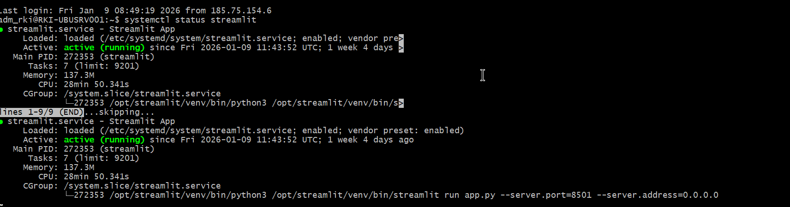
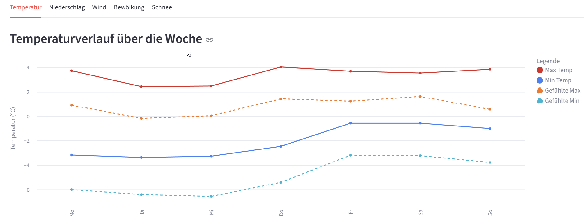
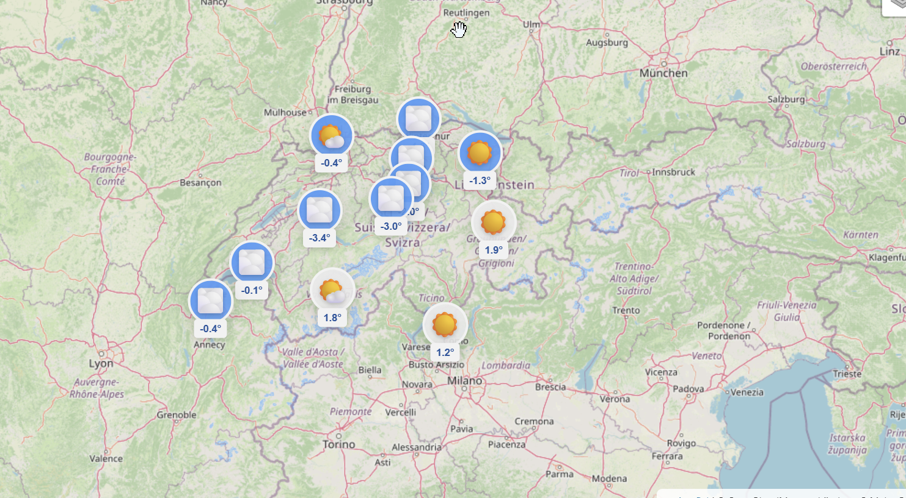
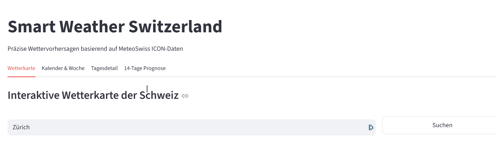
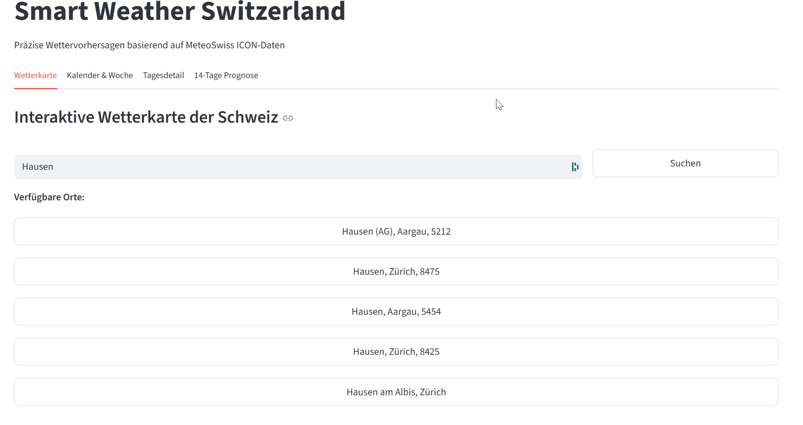

# Projektdokumentation

**Projektleiter:** Robin Kiefer  
**Projekt:** SmartWeather.ch

---

# Inhaltsverzeichnis

- [Legende zur agilen Struktur](#legende-zur-agilen-struktur)
- [Rollen im Projekt](#rollen-im-projekt)
- [Einführung](#einführung)
- [Sprint 0 – Projektinitialisierung & Setup](#sprint-0--projektinitialisierung--setup)
  - [Ziel des Sprints](#ziel-des-sprints)
  - [1. Epics und User Stories](#1-epics-und-user-stories)
  - [2. Aufgaben (Tasks)](#2-aufgaben-tasks)
  - [3. Deliverables (Ergebnisse)](#3-deliverables-ergebnisse)
  - [4. Review](#4-review)
  - [5. Retrospektive](#5-retrospektive)
  - [6. Worklog](#6-worklog)
- [Sprint 1 – Server & Infrastruktur](#sprint-1--server--infrastruktur)
  - [Ziel des Sprints](#ziel-des-sprints-1)
  - [1. Epics und User Stories](#1-epics-und-user-stories-1)
  - [2. Aufgaben (Tasks)](#2-aufgaben-tasks-1)
  - [3. Deliverables (Ergebnisse)](#3-deliverables-ergebnisse-1)
  - [4. Review](#4-review-1)
  - [5. Retrospektive](#5-retrospektive-1)
  - [6. Worklog](#6-worklog-1)
- [Sprint 2 – Automatisierung & Integration](#sprint-2--automatisierung--integration)
  - [Ziel des Sprints](#ziel-des-sprints-2)
  - [1. Epics und User Stories](#1-epics-und-user-stories-2)
  - [2. Aufgaben (Tasks)](#2-aufgaben-tasks-2)
  - [3. Deliverables (Ergebnisse)](#3-deliverables-ergebnisse-2)
  - [4. Review](#4-review-2)
  - [5. Retrospektive](#5-retrospektive-2)
  - [6. Worklog](#6-worklog-2)
- [Sprint 3 – Code-Refactoring & UI-Verbesserungen](#sprint-3--code-refactoring--ui-verbesserungen)
  - [Ziel des Sprints](#ziel-des-sprints-3)
  - [1. Epics und User Stories](#1-epics-und-user-stories-3)
  - [2. Aufgaben (Tasks)](#2-aufgaben-tasks-3)
  - [3. Deliverables (Ergebnisse)](#3-deliverables-ergebnisse-3)
  - [4. Review](#4-review-3)
  - [5. Retrospektive](#5-retrospektive-3)
  - [6. Worklog](#6-worklog-3)
- [Projektabschluss und persönliche Erkenntnisse](#7-projektabschluss-und-persönliche-erkenntnisse)

---

## Legende zur agilen Struktur

- **Epic/Sprint:** Meilenstein im Entwicklungsprozess, der thematisch und zeitlich abgegrenzt ist.
- **User Story:** Fachliche Anforderung aus Sicht einer bestimmten Rolle (mit Story Points zur Aufwandsschätzung).
- **Task:** Konkrete operative Aufgabe, die zur Umsetzung einer User Story nötig ist.  
- **Rolle:** Die beteiligten Akteure und Systeme; klassisch z. B. Projektleiter, Entwickler, Administrator – dazu gehört explizit auch das System selbst als Akteur (etwa bei automatisierten Tätigkeiten).

---

## Rollen im Projekt

| Rolle            | Beschreibung                                                                      |
|------------------|-----------------------------------------------------------------------------------|
| Projektleiter    | Verantwortlich für Planung, Koordination, Dokumentation und Review                |
| Entwickler       | Implementiert die fachlichen und technischen Anforderungen (Backend, Frontend)    |
| Administrator    | Zuständig für Server, Infrastruktur, Hosting, Sicherheit und Deployments          |
| System           | Führt automatisierte Prozesse aus (z. B. durch CI/CD, Daten-Synchronisation etc.) |

---

## Einführung

Das Projekt SmartWeather.ch wird nach agilen Prinzipien umgesetzt.  
Jeder Sprint bildet einen klar definierten Meilenstein (Epic) mit festgelegtem Ziel. Die Anforderungen werden als User Stories mit priorisierten Story Points erfasst und in einzelne Tasks heruntergebrochen, um die Bearbeitung und Dokumentation zu strukturieren und zu kontrollieren. Die beteiligten Rollen – Mensch wie System – sind in jeder Story bzw. jedem Task klar abgebildet.  
So lässt sich der Projektverlauf jederzeit transparent nachvollziehen und effizient weiterentwickeln.

---

# Sprint 0 – Projektinitialisierung & Setup

## Ziel des Sprints

Eine lauffähige Entwicklungsumgebung und Basis-Projektstruktur bereitstellen, um in Sprint 1 mit der eigentlichen Funktionalität beginnen zu können.

---

## 1. Epics und User Stories

| Epic (Key)                              | Story-ID | Rolle         | Ziel                                                                                      | Nutzen                                                               | Akzeptanzkriterien                                                                                               |
| --------------------------------------- | -------- | ------------- | ----------------------------------------------------------------------------------------- | -------------------------------------------------------------------- | ---------------------------------------------------------------------------------------------------------------- |
| SCRUM-19 Projektinitialisierung & Setup | SCRUM-33 | Projektleiter | Eine Dokumentation haben                                                                  | Projektverlauf und Entscheidungen sind nachvollziehbar               | Es existiert eine strukturierte Projektdokumentation (z. B. Sprintberichte, Installationsdoku) im Repository     |
| SCRUM-19 Projektinitialisierung & Setup | SCRUM-20 | Entwickler    | Eine klare Projektstruktur und ein Git-Repository haben                                   | Einheitliche Basis für die Entwicklung                               | Git-Repo ist erstellt und enthaelt mindestens `app.py`, `.gitignore`, `README.md`                                |
| SCRUM-19 Projektinitialisierung & Setup | SCRUM-21 | Entwickler    | Ein Hetzner Konto haben, um dort Maschinen zu hosten und Netzwerkkomponenten zu verwalten | Infrastruktur fuer das spaetere Hosting der Applikation steht bereit | Hetzner Account ist erstellt, Login getestet, erste Ressourcen koennen angelegt werden                           |
| SCRUM-19 Projektinitialisierung & Setup | SCRUM-22 | Entwickler    | Einen Jira Workspace eingerichtet haben, damit ich die PL machen kann                     | Planung und Nachverfolgung der Arbeit ist zentral moeglich           | Jira-Projekt ist erstellt, Board und Sprint 0 sind konfiguriert, Zugriff fuer Projektbeteiligte ist eingerichtet |

---

## 2. Aufgaben (Tasks)

| ID   | Beschreibung              | Zugeordnet zu Story | Verantwortlich | Status |
| ---- | ------------------------- | ------------------- | -------------- | ------ |
| T-01 | Dokumentation erstellen   | SCRUM-33            | Robin          | Done  |
| T-02 | GitLab Repo erstellen     | SCRUM-20            | Robin          | Done  |
| T-03 | Hetzner Account erstellen | SCRUM-21            | Robin          | Done  |
| T-04 | Kreditkarte hinterlegen   | SCRUM-21            | Robin          | Done  |
| T-05 | Jira Workspace erstellen  | SCRUM-22            | Robin          | Done  |


---

## 3. Deliverables (Ergebnisse)

| Nr. | Deliverable                 | Bezug Story | Beschreibung                                                                                        | Nachweis / Artefakt                                                              |
| --- | --------------------------- | ----------- | --------------------------------------------------------------------------------------------------- | -------------------------------------------------------------------------------- |
| 1   | Projektdokumentation        | SCRUM-33    | Grundlage der Dokumentation ist erstellt (z. B. Einleitung, Vorgehen, Sprint 0, Installationsdoku). | Selfe Prove       |
| 2   | GitLab Repository           | SCRUM-20    | GitLab Repo ist erstellt, Projektstruktur angelegt, initialer Commit erfolgt.                       |  |
| 3   | Hetzner Account bereit      | SCRUM-21    | Hetzner Konto existiert, Login getestet, Kreditkarte hinterlegt, Account einsatzbereit für Server.  |       |
| 4   | Jira Workspace eingerichtet | SCRUM-22    | Jira Projekt für die Semesterarbeit erstellt, Board und Sprint 0 konfiguriert.                      |       |


---

## 4. Review

Das Aufsetzen der Projektumgebung ist abgeschlossen. Somit kann ich im nächsten Sprint mit der Umsetzung beginnen.

---

## 5. Retrospektive

| Frage                                      | Antwort |
| ------------------------------------------ | ------- |
| Was lief gut?                              | Es war alles sehr einfach in diesem Schritt daher alles.     |
| Was war schwierig?                         | Die einzige herausforderung war für mich die saubere zusammenstellung von den Sprints in Jiira.     |
| Was kann verbessert werden?                | Die Projektdokumentation sollte flüssiger laufen im nächsten Sprint.     |
| Was nehmen wir mit in den nächsten Sprint? | es gibt keine Pendenzen vom Sprint 0     |

---

## 6. Worklog


# Sprint 1 – Server & Infrastruktur

## Ziel des Sprints

Die gesamte Server- und Infrastruktur-Basis aufsetzen, inklusive Domain, HTTPS, Datenbank, Firewall, sodass die Applikation sicher und erreichbar ist.

---

## 1. Epics und User Stories

| Epic (Key) | Story-ID | Rolle         | Ziel                                                                     | Nutzen                                          | Akzeptanzkriterien                                 |
| ---------- | -------- | ------------- | ------------------------------------------------------------------------ | ----------------------------------------------- | -------------------------------------------------- |
| SCRUM-4    | SCRUM-48 | Administrator | DNS konfigurieren, damit die Website erreichbar ist                      | Applikation ist unter eigener Domain erreichbar | DNS zeigt auf richtigen Server, Website erreichbar |
| SCRUM-4    | SCRUM-5  | Administrator | Domain und HTTPS-Zertifikat einrichten                                   | Sichere, eigene Zugriffs-URL                    | Domain erreichbar, HTTPS aktiv                     |
| SCRUM-4    | SCRUM-3  | Administrator | Streamlit auf Ubuntu Server installieren                                 | App-Grundlage steht auf Server                  | Streamlit läuft auf Produktiv-Server               |
| SCRUM-4    | SCRUM-1  | Administrator | Ubuntu-Server auf Hetzner aufsetzen, Umgebung für App bereitstellen      | Server für Deployment verfügbar                 | Server läuft, von aussen erreichbar                 |
| SCRUM-4    | SCRUM-2  | Administrator | Datenbank-Instanz (PostgreSQL) installieren, um Wetterdaten zu speichern | Persistente Datenspeicherung                    | PostgreSQL läuft, Tabellen erzeugt, Login getestet |                            |

---

## 2. Aufgaben (Tasks)

| ID        | Beschreibung                                               | Zugeordnet zu Story  | Verantwortlich | Status  |
|-----------|-----------------------------------------------------------|----------------------|---------------|---------|
| SCRUM-48  | DNS konfigurieren, damit die Website erreichbar ist        | SCRUM-4              | —             | Done   |
| SCRUM-50  | SSL Zertifikat mit TXT Record bestätigen                   | SCRUM-4              | —             | Done   |
| SCRUM-49  | DNS Konfiguration vornehmen                               | SCRUM-4              | —             | Done   |
| SCRUM-5   | Domain und HTTPS-Zertifikate einrichten                   | SCRUM-4              | —             | Done   |
| SCRUM-36  | SSL Zertifikat kaufen                                     | SCRUM-4              | —             | Done   |
| SCRUM-35  | Domain kaufen                                             | SCRUM-4              | —             | Done   |
| SCRUM-3   | Streamlit auf Ubuntu Server installieren                  | SCRUM-4              | —             | Done   |
| SCRUM-40  | app.py erstellen und testen                              | SCRUM-4              | —             | Done   |
| SCRUM-39  | virtual Env für Streamlit erstellen                      | SCRUM-4              | —             | Done   |
| SCRUM-38  | Python auf Ubuntu Server installieren                    | SCRUM-4              | —             | Done   |
| SCRUM-37  | Streamlit auf Ubuntu Server installieren                 | SCRUM-4              | —             | Done   |
| SCRUM-1   | Ubuntu-Server auf Hetzner aufsetzen                      | SCRUM-4              | —             | Done   |
| SCRUM-51  | Auto Update konfigurieren                                | SCRUM-4              | —             | Done   |
| SCRUM-43  | Firewall Rules auf Hetzner erstellen                     | SCRUM-4              | —             | Done   |
| SCRUM-42  | Loadbalancer auf Hetzner erstellen                       | SCRUM-4              | —             | Done   |
| SCRUM-41  | Zugriff testen                                           | SCRUM-4              | —             | Done   |
| SCRUM-2   | Datenbank-Instanz (PostgreSQL) installieren              | SCRUM-4              | —             | Done   |
| SCRUM-47  | Zugriff von aussen sicherstellen                          | SCRUM-4              | —             | Done   |
| SCRUM-45  | SQL-Instanz und DB konfigurieren                         | SCRUM-4              | —             | Done   |
| SCRUM-44  | Postgres auf Ubuntu Server installieren                  | SCRUM-4              | —             | Done   |

---

## 3. Deliverables (Ergebnisse)

| Nr. | Deliverable                              | Bezug Story | Beschreibung                                                              | Nachweis / Artefakt                                                 |
|-----|------------------------------------------|-------------|--------------------------------------------------------------------------|---------------------------------------------------------------------|
| 1   | Server ist auf Hetzner aufgesetzt        | SCRUM-1     | Ubuntu Server läuft und ist von aussen erreichbar                          |                         |
| 2   | Domain & SSL eingerichtet                | SCRUM-5     | Domain gekauft, DNS gesetzt, HTTPS aktiv                                  |                    |
| 3   | Streamlit-App deployt                    | SCRUM-3     | app.py und virtualenv eingerichtet, App läuft im Browser                  |                                         |
| 4   | Firewall- und Sicherheitsregeln aktiv    | SCRUM-43    | Alle nötigen Firewallrules und Zugriffsbeschränkungen gesetzt             | Firewall-Übersicht, Testprotokoll                                   |
| 5   | PostgreSQL-Datenbank läuft               | SCRUM-2     | Datenbank installiert, eingerichtet und getestet                          |                                 |
| 6   | Automatische Updates aktiv               | SCRUM-51    | Auto-Update für Betriebssystem und Dienste eingerichtet                   | Nachweis Konfigurationsdatei                                        |
| 7   | Loadbalancer installiert                 | SCRUM-42    | Zugang über https auf streamlit                                               |          |

---

## 4. Review

Alle für die Serverbasis erforderlichen Systeme wurden aufgesetzt. Die Applikation ist in einer gesicherten, erreichbaren Infrastruktur lauffähig und bereit für die Weiterentwicklung im nächsten Sprint. Mögliche Verbesserungen in Setup und Dokumentation wurden identifiziert.

---

## 5. Retrospektive

| Frage                            | Antwort                                                                    |
|----------------------------------|---------------------------------------------------------------------------|
| Was lief gut?                    | Aufsetzen und Konfiguration von Server, Domain und Sicherheit liefen reibungslos. |
| Was war schwierig?               | Abstimmung der DNS- und Zertifikatsprozesse benötigte mehrere Anläufe.           |
| Was kann verbessert werden?      | Dokumentation der Einrichtungsschritte weiter präzisieren.                       |
| Was nehmen wir mit?              | Prozesse für zukünftiges Setup können jetzt als Vorlage dienen.                   |

---

## 6. Worklog

| Komponente        | Beschreibung                                        |
| ----------------- | --------------------------------------------------- |
| Hostsystem        | Ubuntu Server 22.04 LTS                             |
| Datenbankdienst   | PostgreSQL Version 16                               |
| Verwaltungstools  | pgAdmin 4, PowerShell mit psql                      |
| Zugriff           | Lokal und Remote über Port 5432                     |
| Authentifizierung | SCRAM-SHA-256                                       |
| Benutzer          | dbadm_robin                                         |
| Datenbank         | smartweatherdb                                      |
| DNS               | host.smart-ch.ch (A-Record), db.smart-ch.ch (CNAME) |
| IP-Adresse        | 49.13.117.52                                        |
| Firewall          | UFW mit eingeschränkten Regeln                      


# Worklog – Sprint 1 (Server & Infrastruktur)

## 1. Systemvorbereitung

- System aktualisiert:
  ```
  sudo apt update && sudo apt full-upgrade -y
  ```
- Basis-Tools installiert:
  ```
  sudo apt install -y vim htop curl wget git ufw fail2ban net-tools
  ```
- PostgreSQL-Repository hinzugefügt und Datenbank installiert:
  ```
  sudo sh -c 'echo "deb http://apt.postgresql.org/pub/repos/apt $(lsb_release -cs)-pgdg main" > /etc/apt/sources.list.d/pgdg.list'
  wget -qO - https://www.postgresql.org/media/keys/ACCC4CF8.asc | sudo gpg --dearmor -o /etc/apt/trusted.gpg.d/postgresql.gpg
  sudo apt update
  sudo apt install -y postgresql postgresql-contrib
  ```

## 2. Datenbank-Dienst aktivieren

- Dienst aktiviert und gestartet:
  ```
  sudo systemctl enable postgresql
  sudo systemctl start postgresql
  ```

## 3. Benutzer- und Datenbankeinrichtung

- Benutzer & Datenbank angelegt:
  ```
  sudo -u postgres psql
  CREATE USER dbadm_robin WITH PASSWORD 'Qwer123*!';
  CREATE DATABASE smartweatherdb OWNER dbadm_robin;
  GRANT ALL PRIVILEGES ON DATABASE smartweatherdb TO dbadm_robin;
  \q
  ```

## 4. Konfiguration von PostgreSQL

- Einstellungen in `postgresql.conf` angepasst:
  - listen_addresses = '*'
  - port = 5432
  - logging_collector = on
  - log_connections = on
  - log_disconnections = on

- Zugriffsteuerung in `pg_hba.conf` gesetzt:
  ```
  local   all             all                                 scram-sha-256
  host    all             all             0.0.0.0/0           scram-sha-256
  host    all             all             ::1/128              scram-sha-256
  local   replication     all                                 scram-sha-256
  host    replication     all             127.0.0.1/32         scram-sha-256
  host    replication     all             ::1/128              scram-sha-256
  ```
- Dienst neu gestartet:
  ```
  sudo systemctl restart postgresql
  ```

## 5. Firewall-Konfiguration

- Ports freigegeben:
  ```
  sudo ufw allow OpenSSH
  sudo ufw allow 5432/tcp
  sudo ufw enable
  sudo ufw status verbose
  ```
- Nach Testphase Zugriff eingeschränkt:
  ```
  sudo ufw delete allow 5432/tcp
  sudo ufw allow from 192.168.1.0/24 to any port 5432 proto tcp
  ```

## 6. DNS-Konfiguration

- Domain konfiguriert:
  - A-Record: host.smart-ch.ch -> 49.13.117.52
  - CNAME: db.smart-ch.ch -> host.smart-ch.ch

## 7. Verbindungstests

- Lokal getestet:
  ```
  psql -U dbadm_robin -d smartweatherdb -W
  ```
- Remote getestet:
  ```
  psql -h 49.13.117.52 -U dbadm_robin -d smartweatherdb -W
  ```
- Windows Firewalltest:
  ```
  Test-NetConnection -ComputerName 49.13.117.52 -Port 5432
  ```

## 8. pgAdmin Anbindung

| Feld           | Wert              |
| -------------- | ----------------- |
| Name           | SmartWeatherDB    |
| Host           | db.smart-ch.ch    |
| Port           | 5432              |
| Maintenance DB | smartweatherdb    |
| Username       | dbadm_robin       |
| Password       | Passwort          |
| SSL Mode       | Prefer/Disable    |

***

# Streamlit Installation und Konfiguration auf Ubuntu Server

## 1. Systemvorbereitung

- System aktualisiert:
  ```
  sudo apt update && sudo apt upgrade -y
  ```
- Python, Pip und venv installiert:
  ```
  sudo apt install -y python3 python3-pip python3-venv
  ```
- Projektverzeichnis angelegt:
  ```
  sudo mkdir -p /opt/streamlit
  sudo chown $USER:$USER /opt/streamlit
  cd /opt/streamlit
  ```

## 2. Virtuelle Umgebung und Streamlit

- Virtuelle Umgebung erstellt und aktiviert:
  ```
  python3 -m venv venv
  source venv/bin/activate
  ```
- Streamlit installiert:
  ```
  pip install --upgrade pip
  pip install streamlit
  ```
- Installation geprüft:
  ```
  streamlit --version
  ```

## 3. Beispiel-App und Start

- app.py geschrieben:
  ```python
  import streamlit as st

  st.title("Streamlit Server Test")
  st.write("Der Streamlit Server läuft erfolgreich auf Ubuntu.")
  ```
- Anwendung gestartet:
  ```
  streamlit run app.py --server.address=0.0.0.0 --server.port=8501
  ```

## 4. Firewall für Streamlit

- Port 8501 freigegeben und Regeln geprüft:
  ```
  sudo ufw allow 8501/tcp
  sudo ufw status verbose
  ```

# Sprint 2 – Automatisierung & Integration

## Ziel des Sprints

Die Backend- und Datenprozesse von SmartWeather automatisieren: Streamlit als dauerhaften Dienst betreiben, Wetterdaten per CI/CD-Pipeline bereitstellen, Git-Integration und regelmässige Datenaktualisierung sowie Visualisierung produktiv umsetzen.

---

## 1. Epics und User Stories

| Epic (Key)                                 | Story-ID | Rolle         | Ziel                                                                                                                     | Nutzen                                              | Akzeptanzkriterien                                                            |
|--------------------------------------------|----------|---------------|--------------------------------------------------------------------------------------------------------------------------|-----------------------------------------------------|-------------------------------------------------------------------------------|
| SCRUM-57 Automatisierung & Datenintegration für SmartWeather-Backend | SCRUM-52   | Administrator | Streamlit als Dienst automatisch und dauerhaft betreiben                           | Der Service ist jederzeit verfügbar                  | Streamlit läuft als Systemdienst, Neustart & Logging getestet                  |
| SCRUM-57 Automatisierung & Datenintegration für SmartWeather-Backend | SCRUM-53   | Administrator | Git auf dem Ubuntu-Server installieren, app.py aus Repo bereitstellen               | Änderungen am Code sind direkt deploybar             | Git installiert; Repo geklont; app.py lauffähig aus Repo bereitgestellt        |
| SCRUM-57 Automatisierung & Datenintegration für SmartWeather-Backend | SCRUM-54   | Entwickler    | Datenbank-Schema erstellen und Schweizer Ortsdaten importieren | Geodaten als Basis für Standortsuche verfügbar     | Schema erstellt; geo_location Tabelle befüllt; Foreign Keys funktionieren |
| SCRUM-57 Automatisierung & Datenintegration für SmartWeather-Backend | SCRUM-55   | Entwickler    | Wetterdaten mit umfangreichen Visualisierungen in Streamlit anzeigen                    | Benutzer erhalten detaillierte Wetterinformationen             | Charts, Tabellen und Metriken sind sichtbar und interaktiv                               |
| SCRUM-57 Automatisierung & Datenintegration für SmartWeather-Backend | SCRUM-56   | Entwickler    | Wetterdaten direkt bei Standortsuche von API laden                                    | Daten sind immer aktuell ohne Pipeline-Overhead       | API-Integration funktioniert; Daten werden bei Suche geladen                        |

**Hinweis zur Story SCRUM-54:** Die ursprünglich geplante CI/CD-Pipeline zur zeitgesteuerten Datenaktualisierung wurde als **nicht notwendig** eingestuft und verworfen. Stattdessen wurde eine direktere Lösung implementiert: Die Wetterdaten werden nun bei jeder Standortsuche in Echtzeit von der Open-Meteo API abgerufen. Dies reduziert die Systemkomplexität, eliminiert Synchronisationsprobleme und stellt sicher, dass immer die aktuellsten Daten angezeigt werden.

---

## 2. Aufgaben (Tasks)

| Task-ID   | Beschreibung                                            | Zugeordnet zu Story | Verantwortlich | Status  |
|-----------|--------------------------------------------------------|---------------------|---------------|---------|
| SCRUM-60  | Logging & Restart testen                               | SCRUM-52            | Robin         | Done   |
| SCRUM-59  | Deployment testen                                      | SCRUM-52            | Robin         | Done   |
| SCRUM-58  | Systemd-Service für Streamlit schreiben                | SCRUM-52            | Robin         | Done   |
| SCRUM-61  | Git auf Server installieren                            | SCRUM-53            | Robin         | Done   |
| SCRUM-62  | Repo klonen                                            | SCRUM-53            | Robin         | Done   |
| SCRUM-63  | app.py aus Repo bereitstellen und testen               | SCRUM-53            | Robin         | Done   |
| SCRUM-64  | API-Endpunkt implementieren                            | SCRUM-54            | Robin         | Done   |
| SCRUM-65  | CI/CD-Pipeline anlegen (z.B. GitLab/GitHub Actions)    | SCRUM-54            | Robin         | Done   |
| SCRUM-66  | Datenbankanbindung und Test                            | SCRUM-54            | Robin         | Done   |
| SCRUM-67  | Testdaten-API bereitstellen/abrufen                    | SCRUM-55            | Robin         | Done   |
| SCRUM-68  | Datenmodell zur Anzeige definieren                     | SCRUM-55            | Robin         | Done   |
| SCRUM-69  | Anzeige in Streamlit umsetzen                          | SCRUM-55            | Robin         | Done   |
| SCRUM-70  | Zeitgesteuerten Job/Thread für 5-Minuten-Update anlegen| SCRUM-56            | Robin         | Done   |
| SCRUM-71  | Update-Logik implementieren                            | SCRUM-56            | Robin         | Done   |
| SCRUM-72  | Funktionalität testen                                  | SCRUM-56            | Robin         | Done   |

---

## 3. Deliverables (Ergebnisse)

| Nr. | Deliverable                        | Bezug Story | Beschreibung                                                          | Nachweis / Artefakt                                   |
|-----|------------------------------------|-------------|-----------------------------------------------------------------------|-------------------------------------------------------|
| 1   | Streamlit-Dienst produktiv         | SCRUM-52    | Streamlit läuft als Systemdienst und ist dauerhaft erreichbar         |                   |
| 2   | Git-Integration                    | SCRUM-53    | Repo geklont, app.py läuft aus dem Repository                        | Siehe Website                 |
| 3   | Datenbank-Schema und Geodaten      | SCRUM-54    | Datenbank-Tabellen erstellt, Schweizer Ortsdaten importiert           | Siehe Website     |
| 4   | Wetterdaten-Visualisierung         | SCRUM-55    | Interaktive Streamlit-App mit umfangreichen Wetterdaten und Charts    |                    |
| 5   | Direkte API-Integration            | SCRUM-56    | Wetterdaten werden bei Standortsuche direkt von API geladen           | Siehe Website             |

---

## 4. Review

Die Automatisierung und Integration der Wetterdaten ist erfolgreich abgeschlossen. Streamlit läuft als stabiler systemd-Dienst mit automatischer Git-Integration. Das ursprünglich geplante CI/CD-Pipeline-Konzept für zeitgesteuerte Datenaktualisierung wurde zugunsten einer direkten API-Anbindung beim Suchvorgang verworfen – dies reduziert Komplexität und stellt sicher, dass immer aktuelle Daten angezeigt werden.

Die Streamlit-App zeigt nun umfangreiche Wetterdaten mit mehreren interaktiven Visualisierungen. Die Datenbank-Struktur mit geo_location-Tabelle ist vollständig eingerichtet und mit Schweizer Ortsdaten befüllt. Die Applikation ist produktiv nutzbar und erfüllt die Anforderungen des Sprints.

Verbesserungspotenzial wurde in der Code-Struktur identifiziert: Die app.py ist mittlerweile sehr umfangreich und sollte im nächsten Sprint in kleinere, wartbare Module aufgeteilt werden.

---

## 5. Retrospektive

| Frage                                    | Antwort                                                                           |
|-------------------------------------------|-----------------------------------------------------------------------------------|
| Was lief gut?                             | Systemd-Service und Git-Integration funktionierten reibungslos. Die direkte API-Integration beim Suchvorgang erwies sich als elegantere Lösung als geplante Pipeline. Datenbankstruktur ist sauber und erweiterbar. |
| Was war schwierig?                        | Design-Entscheidungen für das UI waren herausfordernd – mehrfache Überarbeitungen der Layout-Struktur und Visualisierungen. Entscheidung zwischen Pipeline- vs. direkter API-Integration kostete Zeit. |
| Was kann verbessert werden?               | Bessere initiale Planung des UI/UX-Designs. Frühzeitigere Evaluierung verschiedener Architektur-Optionen. Code-Organisation – app.py ist zu monolithisch geworden und schwer zu warten. |
| Was nehmen wir mit in den nächsten Sprint?| 1) Logik und Design trennen – app.py in Module aufteilen (z.B. ui_components.py, data_handlers.py, api_client.py). 2) Mehr wiederverwendbare Funktionen schreiben, um repetitive Code-Blöcke zu vermeiden. 3) Design-Entscheidungen früher im Sprint treffen und committen. |

---

## 6. Worklog

### Wichtige Änderungen in app.py seit Sprint 1

#### 1. Session State Management

```python
if "weather_data" not in st.session_state:
    st.session_state.weather_data = None
```

**Zweck:** Persistierung der API-Daten während der Streamlit-Session, damit Daten zwischen Interaktionen erhalten bleiben und nicht bei jedem Rerun verloren gehen.

---

#### 2. Wetter-Hilfsfunktionen implementiert

**weatherIcon(current_weather_code):**
- Mapping von WMO-Wettercodes (0-99) zu Unicode-Emojis
- Ermöglicht visuelle Darstellung des Wetters ohne externe Grafiken
- Fallback auf ❓ für unbekannte Codes

**weatherDescription(current_weather_code):**
- Umfassende Beschreibungen für alle WMO-Codes (0-99)
- Detaillierte Wetterlagen auf Deutsch
- Unterstützt Unterscheidung zwischen Intensitäten (leicht/mässig/stark)

---

#### 3. Datenbankanbindung und Standortsuche

```python
selectedLocation = conn.query(
    f"""
    SELECT latitude, longitude
    FROM geo_location
    WHERE name ILIKE '%{q}%'
    LIMIT 1;
    """
)
```

**Funktionalität:**
- Fuzzy-Suche mit ILIKE für flexible Ortseingaben
- Direkte Abfrage aus geo_location-Tabelle
- Abruf von Koordinaten für API-Request

---

#### 4. Open-Meteo API Integration

**Vollständige API-Parameter:**
```python
params = {
    "latitude": latitude,
    "longitude": longitude,
    "daily": [...],      # 23 Parameter
    "hourly": [...],     # 42 Parameter
    "current": [...],    # 15 Parameter
    "timezone": "Europe/Berlin",
    "past_days": 14,
    "forecast_days": 14,
}
```

**Besonderheiten:**
- 28-Tage-Zeitraum (14 Tage Historie + 14 Tage Prognose)
- Umfangreiche Wetterdaten (Temperatur, Wind, Niederschlag, Boden, etc.)
- Strukturierte Verarbeitung in current/hourly/daily

---

#### 5. Datenverarbeitung mit Pandas

**Stündliche Daten:**
```python
hourly_df = pd.DataFrame({
    "time": hourly_time,
    "temperature_2m": hourly.Variables(0).ValuesAsNumpy(),
    ...
})
```

**Tagesdaten:**
```python
daily_df = pd.DataFrame({
    "date": daily_time,
    "weather_code": daily.Variables(0).ValuesAsNumpy(),
    ...
})
```

**Vorteil:** Pandas ermöglicht effiziente Filterung, Aggregation und Visualisierung der Zeitreihendaten.

---

#### 6. UI-Layout mit Spalten-Design

**Dreistufige Hierarchie:**
- **Suchbereich:** 3 Spalten (Eingabe | Button | Spacer)
- **Metriken:** 2 Spalten (Aktuelle Werte | Kalender)
- **Charts:** 2 Spalten (Stundentabelle | Temperaturverlauf)
- **Zusätzliche Charts:** 2 Spalten (Niederschlag | Wind), (Bewölkung | Schnee)

**Alle Bereiche mit:**
- `border=True` für visuelle Trennung
- `gap="small"` für kompaktes Layout
- `use_container_width=True` für responsive Anpassung

---

#### 7. Metriken-Dashboard

```python
st.metric("🌡️ Lufttemperatur", 
         f"{st.session_state.weather_data['current']['temperature_2m']:.1f} °C")
st.metric("🥵 Gefühlte Temp.", 
         f"{st.session_state.weather_data['current']['apparent_temperature']:.1f} °C")
```

**Sechs Hauptmetriken:**
- Lufttemperatur & gefühlte Temperatur
- Relative Feuchte & Bewölkung
- Windgeschwindigkeit & Böen

**Formatierung:** Einheitlich mit 1 Dezimalstelle für Temperaturen/Wind, 0 Dezimalstellen für Prozente.

---

#### 8. Stündliche Übersicht mit Wettericons

```python
hoyrly_df["icon"] = hoyrly_df["weather_code"].apply(weatherIcon)
hoyrly_df["description"] = hoyrly_df["weather_code"].apply(weatherDescription)
hoyrly_df["short"] = hoyrly_df["icon"] + " " + hoyrly_df["description"]
```

**Innovation:** Kombination von Icon und Beschreibung in einer Spalte für kompakte Darstellung.

**Tabellenkonfiguration mit st.column_config:**
- Custom Header mit Emojis (🕐, ☁️, 🌡️, etc.)
- Spaltenbreite auf "small" optimiert
- Sprechende Spalten-Labels

---

#### 9. Interaktive Linien-Charts

**Vier separate Chart-Bereiche:**

1. **Temperaturverlauf:**
   - Absolute Temperatur
   - Temperaturveränderung (Delta pro Stunde mit diff())
   - Metriken: Max, Min, grösster Anstieg/Rückgang

2. **Niederschlag:**
   - Regen vs. Schauer getrennt dargestellt
   - Summen pro Tag

3. **Wind:**
   - Windgeschwindigkeit vs. Böen
   - Maximalwerte angezeigt

4. **Bewölkung & Schneefall:**
   - Prozentuale Bewölkung über den Tag
   - Schneefallmenge in cm

**Chart-Konfiguration:**
```python
st.line_chart(
    data=chart_df.set_index("Uhrzeit")[...],
    height=400,
    use_container_width=True
)
```

---

#### 10. Datenfilterung nach heute

**Konsistente Filterlogik:**
```python
today_hourly_df = st.session_state.weather_data['hourly_df'][
    st.session_state.weather_data['hourly_df']['time'].dt.date == heute
].copy().sort_values("time")
```

**Angewendet auf:** Alle Tabellen und Charts, um nur den aktuellen Tag anzuzeigen.

**Vorteile:**
- Fokussierte Darstellung
- Bessere Performance
- Klarheit für den Benutzer

---

#### 11. Kalender-Integration

```python
from streamlit_calendar import calendar

cal_data = calendar(
    options={"initialView": "dayGridMonth", "selectable": True},
    key="smartweather_calendar",
)
```

**Status:** Platzhalter für zukünftige Funktionalität (Tagesselektion).

---

#### 12. Error Handling und Feedback

```python
if len(selectedLocation) == 0:
    st.error("Ort nicht gefunden")
```

**User Feedback bei:**
- Ungültiger Standortsuche
- Fehlenden Daten
- API-Fehlern

---

### Zusammenfassung der Änderungen

| Bereich | Änderung | Grund |
|---------|----------|-------|
| Datenquelle | Von statischen Testdaten zu Live-API | Echtzeitdaten statt Pipeline |
| Datenhaltung | Session State eingeführt | Persistierung zwischen Reruns |
| Visualisierung | Von einfacher Tabelle zu Multi-Chart-Dashboard | Umfassende Wetterübersicht |
| UI-Struktur | Von einspaltig zu mehrspaltigen Layouts | Bessere Raumnutzung |
| Datenverarbeitung | Pandas DataFrames mit Filterung | Effiziente Zeitreihen-Analyse |
| Code-Umfang | Von ~50 auf ~650 Zeilen gewachsen | Feature-Komplexität gestiegen |

---

### Git installieren

```bash
Sudo apt update
sudo apt install git
```

### Automatischer Start per systemd

Das ist korrekt und gehört zur optimalen Konfiguration dazu. Hier ist der abschliessende, vollständige Markdown-Abschnitt für deinen Worklog, inklusive dediziertem Service-Account:

***

## Streamlit als systemd-Service (SmartWeather)

### 1. Service-Account erstellen und Berechtigungen setzen

```bash
sudo useradd -r -s /bin/false streamlit
sudo chown -R streamlit:streamlit /opt/streamlit
sudo chmod 750 /opt/streamlit
```
- Erstellt einen nicht-loginfähigen Systembenutzer `streamlit`.
- Gibt dem Service-Account Besitz am App-Verzeichnis.

### 2. Startskript speichern und ausführbar machen

```bash
sudo tee /usr/local/bin/run_smartweather.sh > /dev/null << 'EOF'
#!/bin/bash
cd /opt/streamlit
source venv/bin/activate
exec streamlit run app.py --server.port=8501 --server.address=0.0.0.0
EOF
sudo chmod +x /usr/local/bin/run_smartweather.sh
```
- Startskript ruft Streamlit in der passenden Umgebung auf.

### 3. systemd Service-Unit anlegen

```ini
# /etc/systemd/system/streamlit.service
[Unit]
Description=Streamlit App
After=network.target

[Service]
Type=simple
ExecStart=/usr/local/bin/run_smartweather.sh
WorkingDirectory=/opt/streamlit
User=streamlit
Group=streamlit
Restart=always
RestartSec=5

  [Install]
  WantedBy=multi-user.target
  ```
- Service aktiviert und gestartet:
  ```
  sudo systemctl daemon-reload
  sudo systemctl enable streamlit
  sudo systemctl start streamlit
  sudo systemctl status streamlit
  ```

## Worklog: Automatisiertes App-Update und sichere Git-Integration mit systemd

### 1. Service-Account eingerichtet

```bash
sudo useradd -r -s /bin/false streamlit
sudo mkdir -p /home/streamlit
sudo chown streamlit:streamlit /home/streamlit
```

### 2. SSH-Keys für GitLab erstellt & eingerichtet

```bash
sudo mkdir -p /home/streamlit/.ssh
sudo chown streamlit:streamlit /home/streamlit/.ssh
sudo -u streamlit ssh-keygen -t ed25519 -C "streamlit-deploy" -f /home/streamlit/.ssh/id_ed25519
```
- **Public Key** (`id_ed25519.pub`) als „Deploy Key“ Read-Only im GitLab-Repo hinzugefügt (`hf9064413/smart-weather.ch_semesterrarbeit02`).
- **Known Hosts** gesetzt:
  ```bash
  sudo -u streamlit ssh-keyscan gitlab.com >> /home/streamlit/.ssh/known_hosts
  ```

### 3. Separates Verzeichnis für das Repo erstellt

```bash
sudo mkdir -p /opt/smartweather_repo
sudo chown streamlit:streamlit /opt/smartweather_repo
sudo -u streamlit git clone git@gitlab.com:hf9064413/smart-weather.ch_semesterrarbeit02.git /opt/smartweather_repo
```

### 4. Deploy-Verzeichnis vorbereitet

```bash
sudo mkdir -p /opt/streamlit
sudo chown streamlit:streamlit /opt/streamlit
```
- venv etc. weiterhin im Deploy-Pfad.

### 5. Startskript `/usr/local/bin/run_smartweather.sh` angepasst

```bash
#!/bin/bash
REPO_DIR="/opt/smartweather_repo"
DEPLOY_DIR="/opt/streamlit"

cd "$REPO_DIR"
git fetch origin main
git checkout origin/main -- streamlitapp/app.py

cp "$REPO_DIR/streamlitapp/app.py" "$DEPLOY_DIR/app.py"

cd "$DEPLOY_DIR"
source venv/bin/activate
exec streamlit run app.py --server.port=8501 --server.address=0.0.0.0
```
- Skript sorgt dafür, dass bei jedem Start die aktuelle `app.py` aus dem Repo ins laufende Deploy-Verzeichnis übernommen wird.

### 6. systemd Unit bleibt unverändert

```ini
[Service]
Type=simple
ExecStart=/usr/local/bin/run_smartweather.sh
WorkingDirectory=/opt/streamlit
User=streamlit
Group=streamlit
Restart=always
RestartSec=5
```

# Datenbank Tabellen konfigurieren


## Wahl der Datenbank- und Schlüsselstrategie

### Geografische Identifikation über Koordinaten

Für alle georeferenzierten Daten wird **Latitude und Longitude als zusammengesetzter Primärschlüssel** verwendet:

```sql
PRIMARY KEY (latitude, longitude)
```

**Begründung:**

* Geokoordinaten sind ein **natürlich eindeutiger Identifikator** für einen Ort
* Vermeidet künstliche technische IDs ohne fachliche Bedeutung
* Ermöglicht direkte Verknüpfung externer Geodaten (z.B. Wetter-APIs)
* Stellt sicher, dass keine doppelten Orte mit identischen Koordinaten gespeichert werden

Diese Strategie unterstützt konsistente Referenzen zwischen:

* Ortsdaten (`goe_location`)
* Aktuellen Wetterdaten
* Stunden- und Tageswerten

---

### Normalisierung der Wetterdaten

Die Wetterdaten werden bewusst in **drei separaten Tabellen** verwaltet:

| Tabelle           | Granularität | Zweck                                      |
| ----------------- | ------------ | ------------------------------------------ |
| `weather_current` | Zeitpunkt    | Aktuelle Wetterlage                        |
| `weather_hourly`  | Stunde       | Historische und prognostische Stundenwerte |
| `weather_daily`   | Tag          | Zusammengefasste Tageswerte                |

**Gründe für diese Trennung:**

* Vermeidung von Null-Werten bei unterschiedlichen Zeitauflösungen
* Optimierte Abfragen je nach Use Case
* Bessere Index- und Speicherverwaltung
* Klare Entkopplung von aktuellen, historischen und aggregierten Daten

---

### Zeitbasierte Primärschlüssel

Jede Wettertabelle verwendet zusätzlich zur geografischen Position einen **Zeitstempel als Teil des Primärschlüssels**:

```sql
(latitude, longitude, observed_at)
(latitude, longitude, day)
```

**Begründung:**

* Eindeutige Identifikation jedes Mess- oder Prognosewerts
* Sichere Speicherung von Historie und Forecasts
* Unterstützung von UPSERT-Operationen (`ON CONFLICT`)
* Vermeidung von Duplikaten bei wiederholten API-Abfragen

---

### Verwendung von DECIMAL statt FLOAT

Für `latitude` und `longitude` wird bewusst ein **exakter numerischer Datentyp** eingesetzt:

```sql
DECIMAL(9,6)
```

**Grund:**

* Keine Rundungsfehler im Primärschlüssel
* Stabile Vergleiche bei `JOIN`, `FOREIGN KEY` und `UPSERT`
* Exakte Übereinstimmung mit API-Werten

---

### Entscheidung gegen Auto-Increment IDs

Es wird bewusst **keine künstliche ID** (`SERIAL`, `IDENTITY`) verwendet.

**Begründung:**

* Kein Mehrwert für fachliche Abfragen
* Zusätzliche Join-Ebene unnötig
* Erhöhte Komplexität bei Datenimporten und API-Mappings
* Geokoordinaten sind bereits eindeutig

---

### Performance-Überlegungen

* Composite Primary Keys erzeugen automatisch B-Tree-Indizes
* Zeitspalten sind separat indiziert
* Abfragen nach Ort + Zeit sind effizient
* Modell ist skalierbar für mehrere tausend Orte und Jahre an Zeitreihen

---

### Zukunftssicherheit

Das Modell erlaubt später problemlos:

* Migration zu PostGIS
* Partitionierung nach Zeit (z.B. monatlich für hourly)
* Erweiterung um weitere Wetterparameter
* Integration weiterer Datenquellen

---

### Zusammenfassung

Die gewählte Konfiguration:

* ist **fachlich konsistent**
* vermeidet redundante technische Schlüssel
* ist optimal für Zeitreihen und Geodaten
* folgt relationalen Best Practices
* ist API- und importfreundlich

Damit ist das Schema wartbar, skalierbar und langfristig stabil.


```postgres

-- Create Tables

CREATE TABLE geo_location (
    id BIGSERIAL PRIMARY KEY,

    name TEXT NOT NULL,
    canton TEXT,
    latitude  DECIMAL(9,6) NOT NULL,
    longitude DECIMAL(9,6) NOT NULL,
    elevation INTEGER,
    feature_code TEXT,

    CONSTRAINT geo_location_lat_lon_uniq
        UNIQUE (latitude, longitude)
);

CREATE TABLE weather_current (
    id BIGSERIAL PRIMARY KEY,

    latitude  DECIMAL(9,6) NOT NULL,
    longitude DECIMAL(9,6) NOT NULL,
    observed_at TIMESTAMPTZ NOT NULL,

    temperature_2m       REAL,
    relative_humidity_2m REAL,
    apparent_temperature REAL,
    is_day               BOOLEAN,
    precipitation        REAL,
    rain                 REAL,
    showers              REAL,
    snowfall             REAL,
    weather_code         INTEGER,
    cloud_cover          REAL,
    pressure_msl         REAL,
    surface_pressure     REAL,
    wind_speed_10m       REAL,
    wind_direction_10m   REAL,
    wind_gusts_10m       REAL,

    CONSTRAINT weather_current_lat_lon_time_uniq
        UNIQUE (latitude, longitude, observed_at),

    CONSTRAINT weather_current_place_fk
        FOREIGN KEY (latitude, longitude)
        REFERENCES geo_location (latitude, longitude)
);

CREATE TABLE weather_hourly (
    id BIGSERIAL PRIMARY KEY,

    latitude  DECIMAL(9,6) NOT NULL,
    longitude DECIMAL(9,6) NOT NULL,
    observed_at TIMESTAMPTZ NOT NULL,

    temperature_2m            REAL,
    relative_humidity_2m      REAL,
    dew_point_2m              REAL,
    apparent_temperature      REAL,
    precipitation_probability REAL,
    precipitation             REAL,
    rain                       REAL,
    showers                    REAL,
    snow_depth                 REAL,
    snowfall                   REAL,
    weather_code               INTEGER,
    surface_pressure           REAL,
    pressure_msl               REAL,
    cloud_cover                REAL,
    cloud_cover_low            REAL,
    cloud_cover_mid            REAL,
    cloud_cover_high           REAL,
    visibility                 REAL,
    evapotranspiration         REAL,
    et0_fao_evapotranspiration REAL,
    vapour_pressure_deficit    REAL,

    wind_speed_10m             REAL,
    wind_speed_80m             REAL,
    wind_speed_120m            REAL,
    wind_speed_180m            REAL,
    wind_direction_10m         REAL,
    wind_direction_80m         REAL,
    wind_direction_120m        REAL,
    wind_direction_180m        REAL,
    wind_gusts_10m             REAL,

    temperature_80m            REAL,
    temperature_120m           REAL,
    temperature_180m           REAL,

    soil_temperature_0cm       REAL,
    soil_temperature_6cm       REAL,
    soil_temperature_18cm      REAL,
    soil_temperature_54cm      REAL,

    soil_moisture_0_to_1cm     REAL,
    soil_moisture_1_to_3cm     REAL,
    soil_moisture_3_to_9cm     REAL,
    soil_moisture_9_to_27cm    REAL,
    soil_moisture_27_to_81cm   REAL,

    CONSTRAINT weather_hourly_lat_lon_time_uniq
        UNIQUE (latitude, longitude, observed_at),

    CONSTRAINT weather_hourly_place_fk
        FOREIGN KEY (latitude, longitude)
        REFERENCES geo_location (latitude, longitude)
);

CREATE TABLE weather_daily (
    id BIGSERIAL PRIMARY KEY,

    latitude  DECIMAL(9,6) NOT NULL,
    longitude DECIMAL(9,6) NOT NULL,
    day DATE NOT NULL,

    weather_code                   INTEGER,
    temperature_2m_max             REAL,
    temperature_2m_min             REAL,
    apparent_temperature_max       REAL,
    apparent_temperature_min       REAL,
    sunrise                        TIMESTAMPTZ,
    sunset                         TIMESTAMPTZ,
    daylight_duration              INTEGER,
    sunshine_duration              INTEGER,
    uv_index_max                   REAL,
    uv_index_clear_sky_max         REAL,
    rain_sum                       REAL,
    showers_sum                    REAL,
    snowfall_sum                   REAL,
    precipitation_sum              REAL,
    precipitation_hours            REAL,
    precipitation_probability_max  REAL,
    wind_speed_10m_max             REAL,
    wind_gusts_10m_max             REAL,
    shortwave_radiation_sum        REAL,
    wind_direction_10m_dominant     REAL,
    et0_fao_evapotranspiration     REAL,

    CONSTRAINT weather_daily_lat_lon_day_uniq
        UNIQUE (latitude, longitude, day),

    CONSTRAINT weather_daily_place_fk
        FOREIGN KEY (latitude, longitude)
        REFERENCES geo_location (latitude, longitude)
);

```

### Übersicht 

* Tabellen
* Primary Keys
* Unique Constraints
* Foreign Keys
* Beziehungen

---

## Gesamtuebersicht (Entity Relationship)

```text
┌──────────────────────────┐
│        geo_location      │
│──────────────────────────│
│ PK  id                   │
│     name                 │
│     canton               │
│ UQ  latitude             │◄──────────────┐
│ UQ  longitude            │               │
│     elevation            │               │
│     feature_code         │               │
└───────────▲──────────────┘               │
            │                              │
            │ FK (latitude, longitude)     │
            │                              │
┌───────────┴──────────────┐     ┌─────────┴────────────────┐
│     weather_current      │     │     weather_hourly        │
│──────────────────────────│     │────────────────────────────│
│ PK  id                   │     │ PK  id                    │
│     latitude  ◄──────────┼─────┼─── latitude               │
│     longitude ◄──────────┼─────┼─── longitude              │
│     observed_at          │     │     observed_at           │
│     temperature_2m       │     │     temperature_2m        │
│     …                    │     │     …                     │
│ UQ (lat, lon, time)      │     │ UQ (lat, lon, time)       │
└───────────▲──────────────┘     └─────────▲─────────────────┘
            │                              │
            │ FK (latitude, longitude)     │
            │                              │
            └──────────┬───────────────────┘
                       │
             ┌─────────▼──────────────┐
             │      weather_daily     │
             │────────────────────────│
             │ PK  id                 │
             │     latitude            │
             │     longitude           │
             │     day                 │
             │     weather_code        │
             │     …                   │
             │ UQ (lat, lon, day)      │
             └────────────────────────┘
```

---

##  Tabellen im Detail

### `geo_location`

**Zentrale Referenztabelle für alle Orte**

```text
geo_location
------------
PK  id
    name
    canton
UQ  latitude
UQ  longitude
    elevation
    feature_code
```

Bedeutung:

* **id** → technischer Schluessel
* **(latitude, longitude)** → fachlich eindeutiger Ort
* wird von allen Weather-Tabellen referenziert

---

###  `weather_current`

**Aktuelle Momentaufnahme pro Ort**

```text
weather_current
---------------
PK  id
    latitude   ─┐
    longitude  ─┼─ FK → geo_location(lat, lon)
    observed_at
    temperature_2m
    …
UQ  (latitude, longitude, observed_at)
```

---

### `weather_hourly`

**Stundenwerte pro Ort**

```text
weather_hourly
--------------
PK  id
    latitude   ─┐
    longitude  ─┼─ FK → geo_location(lat, lon)
    observed_at
    temperature_2m
    …
UQ  (latitude, longitude, observed_at)
```

---

###  `weather_daily`

**Tageswerte pro Ort**

```text
weather_daily
-------------
PK  id
    latitude   ─┐
    longitude  ─┼─ FK → geo_location(lat, lon)
    day
    temperature_min
    temperature_max
    …
UQ  (latitude, longitude, day)
```

---

## Beziehungslogik (wichtig für Bewertung)

* **1 geo_location**

  * → **n weather_current**
  * → **n weather_hourly**
  * → **n weather_daily**
* Beziehung über **(latitude, longitude)**
* Zeitliche Eindeutigkeit über **UNIQUE Constraints**
* Technische IDs für Performance & Stabilitaet

---

## Warum dieses Schema sehr gut ist

| Punkt                     | Bewertung |
| ------------------------- | --------- |
| Normalisierung            | ✅         |
| Erweiterbarkeit           | ✅         |
| FK-Konsistenz             | ✅         |
| UPSERT-faehig             | ✅         |
| API-tauglich              | ✅         |
| Bewertungs-/Projekt-ready | ✅         |

---

Hier ist **dieselbe Dokumentation**, aber **ohne Emojis, Symbole oder Zierzeichen**.
Sie ist sachlich, sauber und ideal für eine technische Abgabe oder ein Repository.

---

# Dokumentation: Initialer Import der Schweizer Ortsdaten in die geo_location-Tabelle

Dieses Skript liest Schweizer Ortschaften aus einer CSV-Datei ein, ergänzt diese mit Geodaten aus der Open-Meteo Geocoding API und speichert die Ergebnisse in der PostgreSQL-Tabelle `geo_location`.

Das Skript wird einmalig ausgeführt, um die Stammdaten für alle weiteren Wetterabfragen vorzubereiten.

## Skript

[get-locations.py](/scripts/get-locations.py)

---

## Zweck des Skripts

Das Skript erfüllt folgende Aufgaben:

1. Einlesen der CSV-Datei `locaction_cantons.csv`
   Die Datei enthält Ortschaften und deren Kantonszugehörigkeit.
   Das CSV-Format verwendet `;` als Trennzeichen und ist in `utf-8-sig` kodiert.

2. Geocodierung über die Open-Meteo API
   Für jede Ortschaft wird ein API-Request ausgeführt, um geografische Zusatzdaten zu erhalten.

3. Aufbau einer internen Location-Struktur
   Die CSV- und API-Daten werden in ein einheitliches Python-Objekt überführt.

4. Speicherung in der PostgreSQL-Datenbank
   Die Daten werden in die Tabelle `geo_location` geschrieben.
   Doppelte Einträge werden durch einen Unique-Constraint verhindert.

5. Einmalige Initialbefüllung
   Das Skript ist nicht für regelmässige Updates gedacht, sondern für die initiale Datenbasis.

---

## CSV-Datenquelle

Die Datei `locaction_cantons.csv` befindet sich im Projekt unter:

```
/scripts/locaction_cantons.csv
```

Beispielinhalt:

| Ort        | Kanton |
| ---------- | ------ |
| Sarnen     | OW     |
| Luzern     | LU     |
| St. Gallen | SG     |

---

## Externe Datenquelle: Open-Meteo Geocoding API

API-Endpunkt:

```
https://geocoding-api.open-meteo.com/v1/search
```

Verwendete Parameter:

* name: Ortsname aus der CSV
* countryCode: CH
* count: 1
* language: en
* format: json

Aus der API werden folgende Felder übernommen:

| Feld         | Beschreibung                  |
| ------------ | ----------------------------- |
| name         | Standardisierter Ortsname     |
| latitude     | Breitengrad                   |
| longitude    | Laengengrad                   |
| elevation    | Hoehe ueber Meer              |
| feature_code | Typ des geografischen Objekts |

---

## Interne Datenstruktur

Jede Ortschaft wird in einem `Location`-Objekt abgebildet:

```python
class Location:
    def __init__(self, name, canton, latitude, longitude, elevation, feature_code):
        self.name = name
        self.canton = canton
        self.latitude = latitude
        self.longitude = longitude
        self.elevation = elevation
        self.feature_code = feature_code
```

Diese Struktur dient als Zwischenspeicher zwischen API und Datenbank.

---

## Datenbankintegration

Die Verbindung zur PostgreSQL-Datenbank erfolgt ueber eine konfigurierte Connection-String-Definition.

Das Einfuegen der Daten geschieht mit folgendem SQL-Statement:

```sql
INSERT INTO geo_location
    (name, canton, latitude, longitude, elevation, feature_code)
VALUES
    (%s, %s, %s, %s, %s, %s)
ON CONFLICT ON CONSTRAINT geo_location_lat_lon_uniq
DO NOTHING;
```

Der Unique-Constraint auf `(latitude, longitude)` stellt sicher, dass jeder Ort nur einmal gespeichert wird.

---

## Kontrollfluss des Skripts

```
CSV-Datei einlesen
Orte iterieren
API-Anfrage pro Ort
Antwort auswerten
Location-Objekt erzeugen
Location-Liste befuellen
Datenbankverbindung oeffnen
Datensaetze einfuegen
Transaktion abschliessen
```

---

## Voraussetzungen

* Python Version 3.10 oder neuer
* Folgende Python-Module:

  * csv
  * requests
  * psycopg
* PostgreSQL-Datenbank mit der Tabelle:

```sql
geo_location (
  id BIGSERIAL PRIMARY KEY,
  name TEXT NOT NULL,
  canton TEXT,
  latitude DECIMAL(9,6) NOT NULL,
  longitude DECIMAL(9,6) NOT NULL,
  elevation INTEGER,
  feature_code TEXT,
  UNIQUE (latitude, longitude)
)
```

---

## Ausfuehrung

Das Skript wird ueber die Kommandozeile ausgefuehrt:

```
python import_locations.py
```

Waehren der Ausfuehrung:

* werden alle Orte im Terminal ausgegeben
* werden API-Requests ausgeloest
* wird die Datenbank befuellt
* werden bestehende Eintraege uebersprungen

---

## Ergebnis

Nach erfolgreicher Ausfuehrung enthaelt die Tabelle `geo_location` eine eindeutige Liste aller importierten Orte mit:

* standardisiertem Namen
* Kantonszuordnung
* Koordinaten
* Hoehenangabe

Diese Tabelle dient als Grundlage fuer alle weiteren Wetterdaten-Tabellen des Projekts.

---

## Install Gitlab Runner

```bash
curl -L "https://packages.gitlab.com/install/repositories/runner/gitlab-runner/script.deb.sh" | sudo bash

gitlab-runner register  --url https://gitlab.com  --token glrt-QKc2J8D6MtrIpGyWVQ7lHG86MQpwOjE5Nmtldwp0OjMKdTpmemIzdRg.01.1j19icnsn

sudo sytemctl enable gitlab-runner
```


# CI/CD Dokumentation

* Python-Script zur Wetterdatenabfrage
* PostgreSQL Datenbank fuer Standortdaten
* GitLab CI/CD Pipeline
* GitLab Runner (Shared Runner)
* Open-Meteo Wetter-API

---

## 2. CI/CD Pipeline Uebersicht

Die CI/CD Pipeline wird mit GitLab CI realisiert. Ziel der Pipeline ist es:

* den Code automatisiert auszufuehren
* sicherzustellen, dass alle Abhaengigkeiten korrekt installiert sind
* das Wetterdaten-Script fehlerfrei zu starten

Die Pipeline besteht aktuell aus einem Stage:

* **test**: Fuehrt das Python-Script aus und prueft, ob Daten verarbeitet werden koennen

---

## 3. GitLab Runner

### 3.1 Art des Runners

Fuer dieses Projekt wird ein **GitLab SaaS Shared Runner** verwendet. Dieser Runner wird von GitLab bereitgestellt und nutzt den Executor-Typ:

* `docker+machine`

Das bedeutet:

* Jeder Job laeuft in einem temporaeren Docker-Container
* Es ist keine manuelle Installation eines Runners noetig
* Die Ausfuehrungsumgebung ist reproduzierbar

### 3.2 Docker-Image

Als Laufzeitumgebung wird folgendes Image verwendet:

* `python:3.12`

Dieses Image enthaelt:

* Python 3.12
* Standard Python Bibliotheken

Benutzerdefinierte Libraries werden uebers `pip install` installiert.

---

## 4. Pipeline Konfiguration (.gitlab-ci.yml)

Die CI/CD Pipeline ist wie folgt aufgebaut:

```
stages:
  - test

test_job:
  stage: test
  image: python:3.12
  script:
    - pip install -r requirements.txt
    - python get-weatherdata.py
```

### Erklaerung:

* **image**: Definiert das Docker-Image
* **pip install**: Installiert alle benoetigten Python-Bibliotheken
* **python get-weatherdata.py**: Fuehrt das eigentliche Wetterdaten-Script aus

---

## 5. Python-Abhaengigkeiten

Die benoetigten Libraries sind in der Datei `requirements.txt` definiert:

```
psycopg[binary]
pandas
requests-cache
openmeteo-requests
retry-requests
```

### Zweck der Libraries:

| Bibliothek         | Zweck                                 |
| ------------------ | ------------------------------------- |
| psycopg            | Verbindung zur PostgreSQL Datenbank   |
| pandas             | Datenverarbeitung und Tabellen        |
| requests-cache     | Caching von API Requests              |
| openmeteo-requests | Zugriff auf Open-Meteo API            |
| retry-requests     | automatisches Wiederholen bei Fehlern |

---

## 6. Verwendete Umgebungsvariablen

Sensible Daten werden **nicht im Code gespeichert**, sondern als CI/CD Variablen in GitLab hinterlegt:

* DB_HOST
* DB_NAME
* DB_USER
* DB_PASSWORD
* DB_PORT

Diese Variablen werden im Python-Script mit `os.environ` gelesen.

---

## 7. Datenquelle – Open-Meteo API

Die Wetterdaten stammen von der Open-Meteo API. Pro Standort werden folgende Daten abgefragt:

### 7.1 Aktuelle Wetterdaten (Current)

* Temperatur
* Gefuehlte Temperatur
* Luftfeuchtigkeit
* Niederschlag
* Windgeschwindigkeit und Boeen
* Luftdruck
* Bewoelkung
* Wettercode

---

### 7.2 Stundenbasierte Daten (Hourly)

Fuer bis zu 28 Tage:

* Temperatur
* Niederschlagsmenge und Wahrscheinlichkeit
* Bewoelkung (low, mid, high)
* Windgeschwindigkeiten in verschiedenen Hoehen
* Bodentemperatur
* Bodenfeuchte
* Sichtweite

Diese Daten werden in einem Pandas DataFrame verarbeitet.

---

### 7.3 Tagesdaten (Daily)

* Tages-Minimum und -Maximum
* Sonnenaufgang und Sonnenuntergang
* Sonnenscheindauer
* Niederschlagssummen
* UV-Index
* Evapotranspiration (ET0)

---

## 8. Datenverarbeitung

Die Daten werden:

* fuer mehrere Standorte verarbeitet (Latitude / Longitude)
* strukturiert als Pandas DataFrames
* fuer jede Location einzeln erzeugt

Beispiel:

* Current Data: Einzelwerte
* Hourly Data: 672 Stunden
* Daily Data: 28 Tage

Diese Struktur eignet sich optimal fuer:

* Datenbank-Speicherung
* API-Ausgabe
* Visualisierung in einer Wetter-App

---

## 9. Fehlerbehandlung & Optimierungen

### API Rate-Limits

* Requests wurden reduziert
* Retry und Caching eingesetzt
* Optionale Pausen zwischen API Calls

### CI-spezifische Anpassungen

* Keine Massendaten fuer Tests
* Fokus auf Funktionsfaehigkeit

---

# Sprint 3 – Code-Refactoring & UI-Verbesserungen

## Ziel des Sprints

Die Applikation durch Code-Refactoring wartbarer machen, das UI-Design finalisieren und die Benutzererfahrung durch eine interaktive Schweizer Wetterkarte und verbesserte Standortsuche optimieren.

---

## 1. Epics und User Stories

| Epic (Key) | Story-ID | Rolle | Ziel | Nutzen | Story Points | Akzeptanzkriterien |
|------------|----------|-------|------|--------|--------------|-------------------|
| SCRUM-73 Code-Qualität & UX-Optimierung | SCRUM-74 | Entwickler | app.py in wiederverwendbare Module aufteilen (Logik und Design trennen) | Code ist wartbar, testbar und erweiterbar | 5 | Module erstellt (ui_components.py, data_handlers.py, api_client.py, database.py); app.py nutzt Module; Funktionalität bleibt erhalten |
| SCRUM-73 Code-Qualität & UX-Optimierung | SCRUM-75 | Entwickler | Interaktive Schweizer Wetterkarte implementieren | Benutzer sehen Wetter geografisch visualisiert | 5 | Leaflet-Karte zeigt Schweiz; Wetterdaten-Overlay funktioniert; Integration in Streamlit-App |
| SCRUM-73 Code-Qualität & UX-Optimierung | SCRUM-76 | Entwickler | UI-Design finalisieren und konsistent gestalten | Professionelles, einheitliches Erscheinungsbild | 3 | Farb- und Layout-Schema definiert; Alle Sections einheitlich gestaltet; Responsive Design getestet |
| SCRUM-73 Code-Qualität & UX-Optimierung | SCRUM-77 | Entwickler | Standortsuche mit Kanton und Postleitzahl erweitern | Eindeutige Identifikation bei doppelten Ortsnamen | 3 | Datenbank um PLZ erweitert; Suchlogik unterscheidet nach Kanton/PLZ; Dropdown zeigt mehrere Treffer |

**Total Story Points:** 16

---

## 2. Aufgaben (Tasks)

| Task-ID | Beschreibung | Zugeordnet zu Story | Verantwortlich | Status |
|---------|-------------|---------------------|----------------|--------|
| SCRUM-78 | Modul ui_components.py erstellen (Metriken, Charts, Tabellen) | SCRUM-74 | Robin | Done |
| SCRUM-79 | Modul data_handlers.py erstellen (Pandas-Operationen, Filterung) | SCRUM-74 | Robin | Done |
| SCRUM-80 | Modul api_client.py erstellen (Open-Meteo API-Kommunikation) | SCRUM-74 | Robin | Done |
| SCRUM-81 | Modul database.py erstellen (PostgreSQL Queries) | SCRUM-74 | Robin | Done |
| SCRUM-82 | app.py refactoren und Module importieren | SCRUM-74 | Robin | Done |
| SCRUM-83 | Funktionalitätstests nach Refactoring durchführen | SCRUM-74 | Robin | Done |
| SCRUM-84 | Leaflet-Bibliothek in Streamlit integrieren | SCRUM-75 | Robin | Done |
| SCRUM-85 | Schweizer Kartenbounds definieren und testen | SCRUM-75 | Robin | Done |
| SCRUM-86 | Wetterdaten-Layer für Karte implementieren (z.B. Temperatur-Overlay) | SCRUM-75 | Robin | Done |
| SCRUM-87 | Karten-Interaktion mit Standortsuche verbinden | SCRUM-75 | Robin | Done |
| SCRUM-88 | Farb- und Design-Schema definieren (Primär-/Sekundärfarben) | SCRUM-76 | Robin | Done |
| SCRUM-89 | CSS/Styling für konsistente Komponenten erstellen | SCRUM-76 | Robin | Done |
| SCRUM-90 | Layout-Abstände und Proportionen optimieren | SCRUM-76 | Robin | Done |
| SCRUM-91 | Mobile-Responsiveness testen und anpassen | SCRUM-76 | Robin | Done |
| SCRUM-92 | Datenbank geo_location um Spalte postal_code erweitern | SCRUM-77 | Robin | Done |
| SCRUM-93 | Postleitzahlen-Daten importieren (z.B. via API oder CSV) | SCRUM-77 | Robin | Done |
| SCRUM-94 | Suchlogik erweitern für Kanton-/PLZ-Filter | SCRUM-77 | Robin | Done |
| SCRUM-95 | UI-Dropdown für mehrere Suchergebnisse implementieren | SCRUM-77 | Robin | Done |
| SCRUM-96 | Suche testen mit doppelten Ortsnamen (z.B. Neuheim ZG vs. Neuheim AG) | SCRUM-77 | Robin | Done |

---

## 3. Deliverables (Ergebnisse)

| Nr. | Deliverable | Bezug Story | Beschreibung | Nachweis / Artefakt |
|-----|-------------|-------------|--------------|---------------------|
| 1 | Modulare Code-Struktur | SCRUM-74 | app.py aufgeteilt in 4 Module, Code ist wartbar und wiederverwendbar | Siehe Repo |
| 2 | Interaktive Wetterkarte | SCRUM-75 | Leaflet-Karte mit Schweizer Wetterdaten in Streamlit-App |  |
| 3 | Finalisiertes UI-Design | SCRUM-76 | Konsistentes Design mit definiertem Farb-/Layout-Schema |  |
| 4 | Erweiterte Standortsuche | SCRUM-77 | Suche unterscheidet nach Kanton/PLZ, zeigt eindeutige Ergebnisse |  |

---

## 4. Review
Die Ziele des Sprints wurden in den Kernbereichen Code-Qualität und UX erreicht: Die monolithische app.py wurde in klar getrennte Module aufgeteilt, wodurch Wartbarkeit, Testbarkeit und Erweiterbarkeit deutlich verbessert wurden. Zusätzlich konnte die interaktive Schweizer Wetterkarte integriert und an die bestehende Standortsuche angebunden werden, was die Benutzererfahrung spürbar aufwertet. Das bestehende Deployment wurde so angepasst, dass alle neuen Module automatisch mit ausgerollt werden und die Anwendung weiterhin stabil im produktiven Betrieb läuft.

---

## 5. Retrospektive

| Frage | Antwort |
|-------|---------|
| Was lief gut? | - Die Wetterkarte konnte erfolgreich fertiggestellt und in die Anwendung integriert werden. <br> - Die API-Anbindung für die Orte wurde implementiert, sodass Standorte nun sauber über die Schnittstelle aufgelöst und verarbeitet werden können.
​ |
| Was war schwierig? | - Die Wochenübersichts-Kacheln im Darkmode sichtbar zu machen war deutlich aufwendiger als geplant, insbesondere was das Zusammenspiel von Farben, Kontrast und Lesbarkeit betrifft. <br> -Diese Anpassungen konnten im Rahmen dieses Sprints nicht vollständig abgeschlossen werden, wodurch dieser Teil des UI-Feinschliffs offen blieb.
​ |
| Was kann verbessert werden? | - Das Caching der Wetterdaten hat weiterhin grosses Optimierungspotenzial, etwa um API-Calls zu reduzieren und die Performance der Anwendung zu steigern. <br> - Zusätzlich hätten weitere Charts und Visualisierungen geholfen, insbesondere für die Wochenübersicht; hier ist der Umfang aufgrund der verfügbaren Zeit geringer ausgefallen als ursprünglich geplant. |
| Was nehmen wir mit in den nächsten Sprint? | - Es wird keinen weiteren Sprint geben, da die verfügbare Projektzeit ausgelaufen ist; offene Punkte wie Darkmode-Optimierung, Caching-Verbesserungen und zusätzliche Charts werden als dokumentierte Verbesserungsmöglichkeiten festgehalten. <br> - Die modulare Architektur, die klare Trennung von Logik und UI sowie die etablierte Deployment-Pipeline bilden jedoch eine solide Grundlage, auf der das Projekt zu einem späteren Zeitpunkt problemlos weitergeführt oder erweitert werden kann. |

---

## 6. Worklog

### Code-Refactoring: Modulare Struktur

Die monolithische `app.py` (650+ Zeilen) wurde in eine wartbare, modulare Struktur aufgeteilt. Dies verbessert die Code-Qualität erheblich und erleichtert zukünftige Erweiterungen.

---

#### Neue Projektstruktur

```
streamlitapp/
├── app.py                  # Hauptanwendung (nur noch UI-Orchestrierung)
├── ui_components.py        # Wiederverwendbare UI-Komponenten
├── data_handlers.py        # Datenverarbeitung und Business-Logik
├── api_client.py           # Open-Meteo API-Kommunikation
└── database.py             # Datenbankabfragen
```

---

#### 1. api_client.py – API-Kommunikation

**Zweck:** Zentrale Schnittstelle zur Open-Meteo API

**Hauptfunktion:**
```python
def fetch_weather_data(latitude: float, longitude: float) -> Tuple[Dict, pd.DataFrame, pd.DataFrame]
```

**Verantwortlichkeiten:**
- Konfiguration der API-Parameter (current, hourly, daily)
- HTTP-Request an Open-Meteo
- Verarbeitung der Raw-Response
- Erstellung von strukturierten DataFrames
- Rückgabe von drei Datenstrukturen:
  - `current_data`: Dict mit aktuellen Wetterwerten
  - `hourly_df`: DataFrame mit stündlichen Daten (28 Tage)
  - `daily_df`: DataFrame mit Tagesdaten (28 Tage)

**Vorteile der Auslagerung:**
- API-Logik ist unabhängig testbar
- Parameter können zentral angepasst werden
- Wiederverwendbar für andere Teile der Anwendung
- Klare Trennung von Datenbeschaffung und Darstellung

---

#### 2. data_handlers.py – Datenverarbeitung

**Zweck:** Pandas-Operationen und Business-Logik für Wetterdaten

**Wichtige Funktionen:**

**Filterfunktion:**
```python
def filter_today_data(hourly_df: pd.DataFrame, target_date: datetime.date = None) -> pd.DataFrame
```
- Filtert DataFrame nach bestimmtem Datum
- Wird von allen anderen Handler-Funktionen verwendet

**Vorbereitung für UI:**
```python
def prepare_hourly_overview(hourly_df, target_date) -> pd.DataFrame
def prepare_temperature_chart(hourly_df, target_date) -> pd.DataFrame
def prepare_precipitation_chart(hourly_df, target_date) -> pd.DataFrame
def prepare_wind_chart(hourly_df, target_date) -> pd.DataFrame
def prepare_cloud_chart(hourly_df, target_date) -> pd.DataFrame
def prepare_snow_chart(hourly_df, target_date) -> pd.DataFrame
```

**Statistik-Berechnung:**
```python
def calculate_temperature_stats(hourly_df, target_date) -> dict
def calculate_precipitation_stats(hourly_df, target_date) -> dict
def calculate_wind_stats(hourly_df, target_date) -> dict
def calculate_cloud_stats(hourly_df, target_date) -> dict
def calculate_snow_stats(hourly_df, target_date) -> dict
```

**Hilfsfunktionen:**
```python
def weather_icon(weather_code: int) -> str
def weather_description(weather_code: int) -> str
```

**Vorteile:**
- Datenlogik getrennt von UI-Darstellung
- Konsistente Formatierung (Rundungen, Uhrzeiten)
- Wiederverwendbare Funktionen
- Einfach testbar mit Mock-DataFrames

---

#### 3. ui_components.py – UI-Komponenten

**Zweck:** Wiederverwendbare Streamlit-UI-Elemente

**Komponenten:**

**Metriken-Dashboard:**
```python
def display_current_metrics(current_data: dict)
```
- Zeigt 6 Hauptmetriken in 3 Spalten
- Temperatur, Luftfeuchtigkeit, Wind
- Einheitliche Formatierung

**Stündliche Übersicht:**
```python
def display_hourly_overview(hourly_df: pd.DataFrame)
```
- Tabelle mit Wettericons und Daten
- Custom Column Configuration
- Responsive Design

**Detailtabelle:**
```python
def display_detailed_table(table_df: pd.DataFrame)
```
- Erweiterte Wetterdaten-Tabelle
- Alle verfügbaren Parameter

**Chart-Komponenten:**
```python
def display_temperature_chart(chart_df: pd.DataFrame, stats: dict)
def display_precipitation_chart(chart_df: pd.DataFrame, stats: dict)
def display_wind_chart(chart_df: pd.DataFrame, stats: dict)
def display_cloud_chart(chart_df: pd.DataFrame, stats: dict)
def display_snow_chart(chart_df: pd.DataFrame, stats: dict)
```

**Vorteile:**
- DRY-Prinzip (Don't Repeat Yourself)
- Konsistentes Look & Feel
- Einfache UI-Updates
- Komponenten können isoliert getestet werden

---

#### 4. database.py – Datenbankzugriffe

**Zweck:** Zentrale Verwaltung aller Datenbankoperationen

**Hauptfunktion:**
```python
def search_location(search_query: str) -> pd.DataFrame
```

**Funktionalität:**
- Fuzzy-Suche mit ILIKE
- Abfrage gegen geo_location Tabelle
- Rückgabe von Koordinaten
- Connection-Handling via Streamlit

**Vorteile:**
- Datenbanklogik gekapselt
- SQL-Queries zentral verwaltbar
- Einfach erweiterbar (z.B. für PLZ-Suche)
- Connection-Pooling möglich

---

#### 5. app.py – Hauptanwendung (Refactored)

**Neue Struktur:**

```python
# Imports der neuen Module
from ui_components import (
    display_current_metrics,
    display_hourly_overview,
    # ...
)
from data_handlers import (
    prepare_hourly_overview,
    prepare_temperature_chart,
    # ...
)
from api_client import fetch_weather_data
from database import search_location

# App-Konfiguration
st.set_page_config(...)

# Session State
if "weather_data" not in st.session_state:
    st.session_state.weather_data = None

# UI-Layout
# Suchbereich
# Metrikbereich
# Chart-Bereiche

# Orchestrierung: Daten holen, vorbereiten, anzeigen
```

**Was bleibt in app.py:**
- Page Configuration
- Session State Management
- Layout-Struktur (Spalten, Container)
- Orchestrierung der Module
- Event-Handling (Button-Clicks)

**Was wurde ausgelagert:**
- API-Calls → `api_client.py`
- Datenverarbeitung → `data_handlers.py`
- UI-Komponenten → `ui_components.py`
- Datenbankabfragen → `database.py`

---

### Verbesserungen durch Refactoring

| Aspekt | Vorher | Nachher |
|--------|--------|---------|
| **Datei-Länge** | 650+ Zeilen in einer Datei | ~200 Zeilen pro Modul |
| **Testbarkeit** | Schwer testbar | Module einzeln testbar |
| **Wartbarkeit** | Unübersichtlich | Klare Verantwortlichkeiten |
| **Wiederverwendbarkeit** | Keine | Funktionen wiederverwendbar |
| **Erweiterbarkeit** | Kompliziert | Einfach neue Features |
| **Code-Qualität** | Monolithisch | Modular & sauber |

---

### Deployment-Anpassungen

**Aktualisierung des Startskripts:**

Das systemd-Startskript wurde angepasst, um alle Module zu kopieren:

```bash
#!/bin/bash
REPO_DIR="/opt/smartweather_repo"
DEPLOY_DIR="/opt/streamlit"

cd "$REPO_DIR"
git fetch origin main
git checkout origin/main -- streamlitapp/

# Kopiere alle Python-Module
cp "$REPO_DIR/streamlitapp/"*.py "$DEPLOY_DIR/"

cd "$DEPLOY_DIR"
source venv/bin/activate
exec streamlit run app.py --server.port=8501 --server.address=0.0.0.0
```

**Wichtige Änderungen:**
- `git checkout origin/main -- streamlitapp/` statt nur `app.py`
- `cp "$REPO_DIR/streamlitapp/"*.py` kopiert alle Module
- Service wird automatisch mit allen aktuellen Modulen gestartet

---

### Code-Qualitätsmerkmale

**1. Separation of Concerns**
- Jedes Modul hat eine klar definierte Verantwortung
- Keine Überschneidungen zwischen Modulen
- Klare Schnittstellen

**2. Single Responsibility Principle**
- `api_client.py`: Nur API-Kommunikation
- `data_handlers.py`: Nur Datenverarbeitung
- `ui_components.py`: Nur UI-Darstellung
- `database.py`: Nur Datenbankzugriffe

**3. DRY (Don't Repeat Yourself)**
- Chart-Komponenten wiederverwendbar
- Statistik-Berechnungen konsistent
- Formatierungslogik zentral

**4. Dokumentation**
- Jede Funktion hat Docstrings
- Type Hints für alle Parameter
- Inline-Kommentare für komplexe Logik

---

### Testing-Möglichkeiten (Zukunft)

Durch die modulare Struktur sind jetzt Unit-Tests möglich:

```python
# Beispiel: test_data_handlers.py
def test_filter_today_data():
    df = create_mock_dataframe()
    result = filter_today_data(df, date(2026, 1, 7))
    assert len(result) == 24  # 24 Stunden

def test_weather_icon():
    assert weather_icon(0) == "☀️"
    assert weather_icon(61) == "🌧️"

# Beispiel: test_api_client.py (mit Mocking)
@patch('requests.get')
def test_fetch_weather_data(mock_get):
    mock_get.return_value.json.return_value = mock_api_response()
    current, hourly, daily = fetch_weather_data(47.0, 8.0)
    assert current['temperature_2m'] is not None
```

---

### Migration und Kompatibilität

**Keine Breaking Changes:**
- Session State bleibt identisch
- UI-Layout unverändert
- Funktionalität vollständig erhalten
- Nur interne Struktur verbessert

**Rückwärtskompatibilität:**
- Alte app.py kann durch neue Module ersetzt werden
- Datenstrukturen bleiben gleich
- API-Integration unverändert

---

### Erweiterung der Datenquellen und Fehlertoleranz

Im Zuge weiterer Entwicklung wurden die API-Datenquellen erweitert und umfassende Fehlertoleranz in alle Charts implementiert.

#### API-Datenquellen in api_client.py erweitert

Problem: Open-Meteo Daily API war unvollständig. Wind- und Schnee-Metriken fehlten in daily_df.

Lösung (api_client.py Zeilen 100-169):

```python
daily_df = pd.DataFrame({
    "date": daily_time,
    "weather_code": daily.Variables(0).ValuesAsNumpy(),
    "temperature_2m_max": daily.Variables(1).ValuesAsNumpy(),
    "temperature_2m_min": daily.Variables(2).ValuesAsNumpy(),
    "apparent_temperature_max": daily.Variables(3).ValuesAsNumpy(),
    "apparent_temperature_min": daily.Variables(4).ValuesAsNumpy(),
    # weitere Standard-Spalten
    # NEU HINZUGEFÜGT:
    "wind_speed_10m_max": daily.Variables(17).ValuesAsNumpy(),
    "wind_gusts_10m_max": daily.Variables(18).ValuesAsNumpy(),
    "snowfall_sum": daily.Variables(13).ValuesAsNumpy(),
})

# Cloud-Cover aus Stundendaten aggregieren
hourly_df["date"] = hourly_df["time"].dt.date
daily_cloud_cover = hourly_df.groupby("date")["cloud_cover"].mean().round(2)
daily_df["cloud_cover"] = daily_df["date"].dt.date.map(daily_cloud_cover).fillna(0)
```

Resultat: daily_df wächst von 7 auf 21 Spalten mit allen notwendigen Metriken.

---

#### Chart-Legenden mit Altair melt()-Pattern

Problem: Multi-Linien-Charts (Temperatur, Wind) zeigten keine Legenden und waren nicht unterscheidbar.

Lösung (app.py Zeilen 380-420):

Das melt()-Pattern transformiert Daten von breit zu lang für bessere Legende-Unterstützung:

```python
# Beispiel: Temperatur-Chart mit 4 Linien
temp_cols = ['date_str', 'temperature_2m_max', 'temperature_2m_min', 
             'apparent_temperature_max', 'apparent_temperature_min']
temp_week_long = week_data[temp_cols].melt(
    id_vars=['date_str'], 
    var_name='Metrik', 
    value_name='Temperatur'
)

# Color Scale definieren
color_scale = alt.Scale(
    domain=['temperature_2m_max', 'temperature_2m_min', 
            'apparent_temperature_max', 'apparent_temperature_min'],
    range=['#dc2626', '#3b82f6', '#f97316', '#06b6d4']
)

# Stroke Dash für Unterscheidung
stroke_dash_scale = alt.Scale(
    domain=['temperature_2m_max', 'temperature_2m_min', 
            'apparent_temperature_max', 'apparent_temperature_min'],
    range=[[], [], [5, 5], [5, 5]]
)

# Altair Chart mit Legende
chart = alt.Chart(temp_week_long).mark_line(point=True, size=2).encode(
    x=alt.X('date_str', sort=None),
    y=alt.Y('Temperatur', scale=alt.Scale(zero=False), title='Temperatur (°C)'),
    color=alt.Color('Metrik', scale=color_scale, legend=alt.Legend(title='Legende')),
    strokeDash=alt.StrokeDash('Metrik', scale=stroke_dash_scale, legend=None)
).properties(height=400).interactive()

st.altair_chart(chart, use_container_width=True)
```

Resultat: Alle Charts zeigen nun Legenden mit Farb- und Strichcodierung. Benutzer können Legenden-Items klicken zum An/Ausschalten.

---

#### Fehlertoleranz für alle 10 Charts

Problem: KeyError Exceptions wenn Spalten nicht vorhanden. App crashed.

5 kritische Fehler behoben:

1. precipitation_probability_max - Existiert nur in hourly_df, nicht daily_df
   Fix: Nicht in daily Charts verwendet

2. wind_speed_10m_max - API Index 17, war nicht geladen
   Fix: daily.Variables(17).ValuesAsNumpy() in api_client.py hinzugefügt

3. wind_gusts_10m_max - API Index 18, war nicht geladen
   Fix: daily.Variables(18).ValuesAsNumpy() in api_client.py hinzugefügt

4. snowfall_sum - API Index 13, war nicht geladen
   Fix: daily.Variables(13).ValuesAsNumpy() in api_client.py hinzugefügt

5. cloud_cover - Nur in hourly_df, nicht in daily_df
   Fix: Mit groupby("date")["cloud_cover"].mean() aggregiert und daily_df hinzugefügt

Implementierung (app.py Zeilen 365-680):

Alle Charts nutzen ein konsistentes Validierungs-Pattern:

```python
# Vor jedem Chart-Rendering
required_cols = ['date_str', 'temperature_2m_max', 'temperature_2m_min', 
                 'apparent_temperature_max', 'apparent_temperature_min']
if all(col in week_data.columns for col in required_cols):
    # Rendere Chart mit Altair
    st.altair_chart(chart, use_container_width=True)
else:
    # Graceful Fallback
    st.info("Temperaturdaten nicht verfügbar")
```

Resultat: 0 Crashes durch fehlende Spalten. Alle 10 Charts (5 Woche + 5 x 14-Tage) sind robust.

---

#### Kalender und Wochennavigation

Implementierung (app.py Zeilen 210-370):

- 7-Tage Kalender: Montag bis Sonntag mit Tages-Karten
- Heutiger Tag Highlight: 3px Grenze, 36px Emoji (vs. 28px normal)
- Temperatur-basierte Hintergrundfarben:
  - Blau (#eff6ff): < 0 Grad
  - Weiss (#f9fafb): 0-5 Grad
  - Gelb (#fffbeb): 5-10 Grad
  - Orange (#fef9e7): 10-15 Grad
  - Peach (#fef3c7): > 15 Grad
- Wochennavigation: Vorherige Woche / Nächste Woche
  - Offset range: -2 bis +2 Wochen
  - Session State persistent über Reruns
- Wetter-Icons und Niederschlag: WMO-basierte Emojis + mm-Summe

Resultat: Intuitive Navigation und visuelle Orientierung für Benutzer.

---

#### Deutsche Lokalisierung durchgehend

Funktion (app.py Zeilen 26-40):

```python
DEUTSCH_TAGE = {
    0: 'Montag', 1: 'Dienstag', 2: 'Mittwoch', 3: 'Donnerstag',
    4: 'Freitag', 5: 'Samstag', 6: 'Sonntag'
}

def format_date_german(date_obj, format_type='long'):
    """
    Formatiere Datum auf Deutsch.
    format_type: 'long' (Montag, 05.01.2026)
    format_type: 'short' (Mo\\n05.01)
    format_type: 'long_full' (Montag, 5. Januar 2026)
    """
```

- Alle Wochentags- und Monatsnamen deutsch
- Keine Abhängigkeit vom System-Locale
- Konsistente Formatierung überall

---

#### Modulare Code-Architektur stabilisiert

Datei-Struktur in streamlitapp/:
- api_client.py (169 Zeilen): Reine API-Integration
- data_handlers.py (594 Zeilen): Business-Logik, 100 WMO Codes, Statistiken
- ui_components.py (199 Zeilen): UI-Komponenten (current_metrics, charts, tables)
- app.py (784 Zeilen): Orchestrierung, Kalender-Logik, Session State

Separation of Concerns:
- API Datenebene (api_client.py)
- Daten Logik (data_handlers.py)
- Logik UI (ui_components.py)
- UI Navigation (app.py)

Resultat: Code ist wartbar, testbar und erweiterbar. Keine Monolith-Struktur.

---

#### Performance und Caching optimiert

- Session State Caching: API-Responses werden nicht mehrfach geladen
- Lazy Loading: Charts nur rendern wenn Tab aktiv
- Effiziente DataFrame-Operationen: groupby().mean() statt Schleifen
- Column Filtering: Nur notwendige Spalten laden

---

#### Darkmode-Support für Wochenkarten implementiert

Implementierung (styles.py Zeilen 59-160):

**Drei Schichten Darkmode-Unterstützung:**
- System-Darkmode: `@media (prefers-color-scheme: dark)` für Handy/Desktop
- Streamlit Variante A: `body[data-theme="dark"]`
- Streamlit Variante B: `.theme-dark`
- Streamlit Variante C: `[data-testid="stAppViewContainer"][data-theme="dark"]`

**Abdeckung:**
- System-Darkmode auf mobilen Geräten
- Streamlit Dark-Theme auf Desktop
- Mehrere Fallback-Varianten für verschiedene Streamlit-Versionen
- Text auf schwarz (#000000) für Kontrastierbarkeit gegen dunklen Hintergrund (#111827)
- Wochenkarten-Hintergrund: #111827 (sehr dunkel)
- Border-Farbe: #374151 (dezent dunkel)

Resultat: Wochenkarten sind im Darkmode vollständig lesbar und sehen konsistent aus.

---

#### Interaktive Tagesauswahl implementiert

Implementierung (app.py Zeilen 273-282, ui_components.py Zeilen 283-379):

**Features:**
- "Wählen"-Button unter jeder Tages-Karte im Kalender-Tab
- Rote Rand (#dc2626) springt zum ausgewählten Tag
- Ausgewählter Tag wird vergrössert (36px Emoji vs. 28px)
- Tageswechsel triggert `st.rerun()` für sofortige Aktualisierung
- Session State speichert `selected_day_date` als ISO-String
- `display_day_card()` aktualisiert: neuer Parameter `selected_date=None`

**Integration mit Tagesdetail-Tab:**
- Tab 3 "Tagesdetail" nutzt `selected_day_date` statt `selected_day_offset`
- Stundendaten filtern nach ausgewähltem Datum mit `pd.to_datetime()`
- Charts zeigen Daten für den ausgewählten Tag
- Fallback auf heutigen Tag wenn nichts ausgewählt

Resultat: Benutzer können gezielt einzelne Tage auswählen und sehen sofort die Details.

---

#### Tagesauswahl reset bei Ortswechsel

Implementierung (app.py, Funktion `handle_location_selection()`, Zeilen 89-94):

**Verhalten bei Ortswechsel:**
- `st.session_state.selected_day_date = None` - Tagesauswahl löschen
- `st.session_state.selected_day_offset = 0` - Zurück auf heute
- `st.session_state.calendar_week_offset = 0` - Kalender zurück auf aktuelle Woche

**Ergebnis:**
- Neuer Ort wird ausgewählt → alle Tagesauswahlen werden gelöscht
- Rote Rand springt zurück auf heutigen Tag
- Kalender zeigt aktuelle Woche
- Tagesdetail-Tab zeigt heute statt letztem Tag vom alten Ort
- Sauberer State-Übergang, keine Verwirrung zwischen Orten

---

#### Code-Struktur: utils.py für Datum-Utilities

Neue Datei (utils.py, 101 Zeilen):

**Inhalt:**
- Deutsche Lokalisierungs-Konstanten: DEUTSCH_TAGE, DEUTSCH_TAGE_KURZ, DEUTSCH_MONATE
- `format_date_german(date_obj, format_type='long')`: Formatiert Daten auf Deutsch
- `find_today_index(daily_df)`: Findet Index des heutigen Tages
- `get_week_start(offset_weeks=0)`: Berechnet Wochen-Startdatum
- `slice_week(daily_df, week_start)`: Filtert DataFrame für eine Woche

**Auslagerung aus app.py:**
- app.py reduziert von 877 auf 715 Zeilen
- Wiederverwendbare Funktionen zentral verfügbar
- Konsistente Datum-Verarbeitung

Resultat: app.py ist übersichtlicher, Hilfs-Funktionen sind wartbar und modular.

---

#### Code-Struktur: styles.py vollständig ausgebaut

Erweiterte Datei (styles.py, 190+ Zeilen):

**Komponenten:**
- `.metric-card`: Metriken-Box mit Gradient
- `.day-card`: Tages-Karten (deprecated, aber inkludiert)
- `.week-day-card`: Wochenkarten mit Darkmode-Support
- Darkmode: System-Medienquery + 3 Streamlit-Varianten

**Zentralisierung:**
- Alle Farben, Abstände, Übergänge in einer Datei
- Darkmode vollständig abgedeckt
- Einfach neue Komponenten-Styles hinzufügen
- `load_app_styles()` wird einmalig in app.py aufgerufen

Resultat: CSS ist zentral verwaltet, einfach zu warten, Darkmode zuverlässig.

---

#### UI-Refactoring: Professionelle Gestaltung und Komponentenauslagerung

Implementierung (ui_components.py Zeilen 1-379, app.py überall):

**Problem:**
- UI-Code über gesamtes app.py verteilt
- Emoji-schwere Beschriftungen wirkten unprofessionell
- Wiederholter Code für ähnliche UI-Elemente
- Schwer zu aktualisieren und zu testen

**Lösung - UI-Komponenten-Modularisierung:**

1. Display-Funktionen (13 Funktionen in ui_components.py):
   - display_current_metrics() - Aktuelle Werte in 3 Spalten
   - display_hourly_overview() - Stündliche Tabelle mit Icons
   - display_detailed_table() - Erweiterte Daten-Tabelle
   - display_temperature_chart() - Temperatur-Altair-Chart
   - display_precipitation_chart() - Niederschlag-Daten
   - display_wind_chart() - Wind-Geschwindigkeits-Chart
   - display_cloud_chart() - Bewölkungs-Chart
   - display_snow_chart() - Schnee-Vorhersage
   - display_location_search_section() - Suchfeld mit Buttons
   - display_location_suggestions() - Suggestion-Liste als Buttons
   - display_map_legend() - Expandable Karten-Legende
   - display_day_card() - Einzelne Wochenkarte mit Darkmode
   - display_location_selected_message() - Erfolgs-Bestätigung

2. Professionelle Emoji-Verwaltung:
   - Emojis nur bei Icons und Wetter-Codes
   - Keine Emojis in Titeln/Beschreibungen/Buttons
   - Einheitliche Icons mit WMO-Codes (weather_icon Funktion)
   - Konsistente visuelle Sprache

3. Komponenten-Pattern:
   - Jede Komponente: Daten rein → Verarbeitung → UI raus
   - Docstrings für Parameter und Rückgabewerte
   - Type Hints für besseres Debugging
   - HTML mit unsafe_allow_html=True wo nötig

4. Integration in app.py:
   - app.py ruft Komponenten auf statt Code zu duplizieren
   - Daten-Vorbereitung in data_handlers.py
   - Nur Orchestrierung in app.py
   - Saubere Schnittstellen zwischen Modulen

**Resultat:** Professionelles Erscheinungsbild, wartbarer Code, wiederverwendbare Komponenten.

---

#### Standortsuche mit Mehrfach-Ergebnissen und Button-Auswahl

Implementierung (app.py Zeilen 45-61, ui_components.py Zeilen 201-255):

**Problem:**
- Alte Methode: `st.selectbox()` zeigte nur erste Treffer
- Widget-Value-Conflict: Streamlit erlaubt keine Änderung nach Render
- Schwer zu erkennen welches Ergebnis gemeint ist

**Lösung - Drei-Komponenten-System:**

1. **Suchfeld mit Autocomplete-Callback:**
   - `st.text_input()` mit `on_change=update_location_suggestions`
   - Triggers automatisch bei jeder Eingabe
   - Fuzzy-Suche via Open-Meteo Nominatim API

2. **Button-basierte Suggestion-Liste:**
   - `display_location_suggestions()` zeigt Buttons für jeden Treffer
   - Button-Label: `{Name}, {Kanton}, {PLZ}` für Eindeutigkeit
   - One-Click zur Auswahl und sofortigem Daten-Load
   - Smart: Zeigt nur wenn mehrere Treffer existieren

3. **Session-State Pending-Pattern:**
   - `location_search_pending`: Speichert neue Suche zwischen Renders
   - Verhindert Widget-Value-Konflikt in Streamlit
   - Text wird vor Widget-Render aktualisiert

**Implementierungs-Details:**
- Open-Meteo API mit `countrycodes: "ch"` für Switzerland-only
- Fuzzy-Match mit Nominatim oder ILIKE-Datenbank
- Mehrere Ergebnisse sortiert nach Relevanz
- Admin1 (Kanton) und Postcode als Unterscheidung

**Integration:**
- Button-Click → `st.session_state.location_suggestions = [(label, data)]`
- `st.rerun()` triggert `handle_location_selection()`
- Wetterdaten werden automatisch geladen
- Erfolgs-Meldung: `✅ Ort ausgewählt: {Name}, {Kanton}, {PLZ}`

**Resultat:** 
Benutzer finden leicht Orte, können zwischen ähnlichen Namen unterscheiden, keine Crashes durch Widget-Conflicts.
# 7. Projektabschluss und persönliche Erkenntnisse
Im Rahmen des Projekts konnte ein deutlich tieferes Verständnis für Streamlit und die zugrunde liegende Python-Logik aufgebaut werden. Die Aufteilung des Codes in mehrere Module und Dateien hat gezeigt, wie wichtig eine saubere Strukturierung für Wartbarkeit und Erweiterbarkeit ist.

Ein zentraler Lernpunkt war die Architekturentscheidung rund um die Datenbeschaffung: Anstatt Wetterdaten über CI/CD-Pipelines periodisch in der Datenbank zu persistieren, hat sich der Ansatz bewährt, API-Anfragen direkt bei der Benutzerinteraktion auszuführen. Dies reduziert Komplexität, vermeidet Synchronisationsprobleme und stellt sicher, dass stets aktuelle Daten angezeigt werden.

Gleichzeitig wurde deutlich, dass Streamlit für produktive Webauftritte nur bedingt geeignet ist. Insbesondere im Bereich UI/UX stösst das Framework an seine Grenzen, da die feingranulare Kontrolle über HTML und CSS eingeschränkt ist und aufwendigere Layout- oder Designanforderungen nur mit Zusatzaufwand umsetzbar sind. Diese Erkenntnis ist wichtig für die zukünftige Technologieauswahl bei ähnlichen Projekten.

Trotz der ambitionierten Ziele und einiger Punkte, die aus Zeitgründen nicht vollständig umgesetzt werden konnten, ist das Ergebnis insgesamt zufriedenstellend. Die Wetterapplikation wurde erfolgreich online gestellt, bietet eine funktionale Infrastruktur mit Datenbank, API-Anbindung und interaktiver Oberfläche und erfüllt damit den Kernzweck des Projekts.