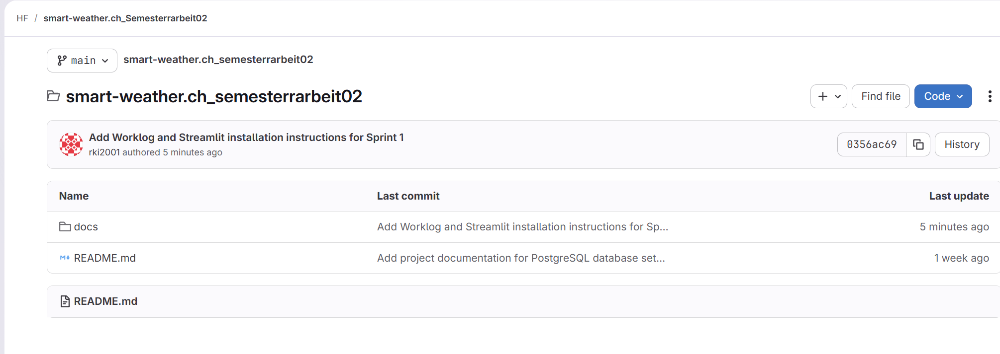
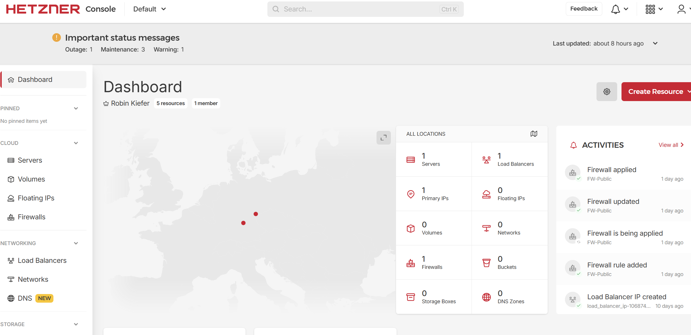
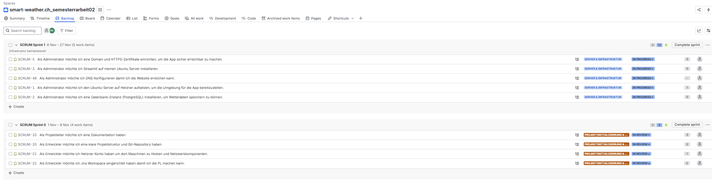

# Projektdokumentation

**Projektleiter:** Robin Kiefer
**Projekt:** SmartWeather.ch

## Legende

Die Sprints bestehen aus Stories welche gleichzeitig die Auszuführenden Tasks sind und diese zusammengesetzt in einer Epic welche als Meilenstein dient.

## Introduction


-	Entwicklung eines Python-Skripts, das Wetterdaten (z.B. OpenWeatherMap) abruft und verarbeitet.

-	Aufbau einer Supabase-Datenbank inkl. API-Integration zur Speicherung der Wetterdaten.

-	Einrichtung einer GitLab CI/CD Pipeline, die das Python-Skript automatisiert ausführt und die Daten aktualisiert.

-	Implementierung einer Streamlit-Webanwendung zur Visualisierung der gesammelten Wetterdaten.

-	Optional: Erweiterung um Funktionen wie Vergleich mehrerer Orte oder Benachrichtigungen bei Extremwetter.


---

# Sprint 0 – Projektinitialisierung & Setup

## Ziel des Sprints

Eine lauffähige Entwicklungsumgebung und Basis-Projektstruktur bereitstellen, um in Sprint 1 mit der eigentlichen Funktionalität beginnen zu können.

---

## 1. Epics und User Stories

| Epic (Key)                              | Story-ID | Rolle         | Ziel                                                                                      | Nutzen                                                               | Akzeptanzkriterien                                                                                               |
| --------------------------------------- | -------- | ------------- | ----------------------------------------------------------------------------------------- | -------------------------------------------------------------------- | ---------------------------------------------------------------------------------------------------------------- |
| SCRUM-19 Projektinitialisierung & Setup | SCRUM-33 | Projektleiter | Eine Dokumentation haben                                                                  | Projektverlauf und Entscheidungen sind nachvollziehbar               | Es existiert eine strukturierte Projektdokumentation (z. B. Sprintberichte, Installationsdoku) im Repository     |
| SCRUM-19 Projektinitialisierung & Setup | SCRUM-20 | Entwickler    | Eine klare Projektstruktur und ein Git-Repository haben                                   | Einheitliche Basis für die Entwicklung                               | Git-Repo ist erstellt und enthaelt mindestens `app.py`, `.gitignore`, `README.md`                                |
| SCRUM-19 Projektinitialisierung & Setup | SCRUM-21 | Entwickler    | Ein Hetzner Konto haben, um dort Maschinen zu hosten und Netzwerkkomponenten zu verwalten | Infrastruktur fuer das spaetere Hosting der Applikation steht bereit | Hetzner Account ist erstellt, Login getestet, erste Ressourcen koennen angelegt werden                           |
| SCRUM-19 Projektinitialisierung & Setup | SCRUM-22 | Entwickler    | Einen Jira Workspace eingerichtet haben, damit ich die PL machen kann                     | Planung und Nachverfolgung der Arbeit ist zentral moeglich           | Jira-Projekt ist erstellt, Board und Sprint 0 sind konfiguriert, Zugriff fuer Projektbeteiligte ist eingerichtet |

---

## 3. Aufgaben (Tasks)

| ID   | Beschreibung              | Zugeordnet zu Story | Verantwortlich | Status |
| ---- | ------------------------- | ------------------- | -------------- | ------ |
| T-01 | Dokumentation erstellen   | SCRUM-33            | Robin          | To Do  |
| T-02 | GitLab Repo erstellen     | SCRUM-20            | Robin          | To Do  |
| T-03 | Hetzner Account erstellen | SCRUM-21            | Robin          | To Do  |
| T-04 | Kreditkarte hinterlegen   | SCRUM-21            | Robin          | To Do  |
| T-05 | Jira Workspace erstellen  | SCRUM-22            | Robin          | To Do  |


---

## 4. Deliverables (Ergebnisse)

| Nr. | Deliverable                 | Bezug Story | Beschreibung                                                                                        | Nachweis / Artefakt                                                              |
| --- | --------------------------- | ----------- | --------------------------------------------------------------------------------------------------- | -------------------------------------------------------------------------------- |
| 1   | Projektdokumentation        | SCRUM-33    | Grundlage der Dokumentation ist erstellt (z. B. Einleitung, Vorgehen, Sprint 0, Installationsdoku). | Selfe Prove       |
| 2   | GitLab Repository           | SCRUM-20    | GitLab Repo ist erstellt, Projektstruktur angelegt, initialer Commit erfolgt.                       |  |
| 3   | Hetzner Account bereit      | SCRUM-21    | Hetzner Konto existiert, Login getestet, Kreditkarte hinterlegt, Account einsatzbereit für Server.  |       |
| 4   | Jira Workspace eingerichtet | SCRUM-22    | Jira Projekt für die Semesterarbeit erstellt, Board und Sprint 0 konfiguriert.                      |       |


---

## 6. Review

Das Aufsetzen der Projektumgebung ist abgeschlossen. Somit kann ich im nächsten Sprint mit der Umsetzung beginnen.

---

## 7. Retrospektive

| Frage                                      | Antwort |
| ------------------------------------------ | ------- |
| Was lief gut?                              | Es war alles sehr einfach in diesem Schritt daher alles.     |
| Was war schwierig?                         | Die einzige herausforderung war für mich die saubere zusammenstellung von den Sprints in Jiira.     |
| Was kann verbessert werden?                | Die Projektdokumentation sollte flüssiger laufen im nächsten Sprint.     |
| Was nehmen wir mit in den nächsten Sprint? | es gibt keine Pendenzen vom Sprint 0     |

---

## 9. Worklog


# Sprint 1 – Server & Infrastruktur

## Ziel des Sprints

Die gesamte Server- und Infrastruktur-Basis aufsetzen, inklusive Domain, HTTPS, Datenbank, Firewall, sodass die Applikation sicher und erreichbar ist.

---

## 1. Epics und User Stories

| Epic (Key)   | Story-ID   | Rolle           | Ziel                                                                                | Nutzen                                                      | Akzeptanzkriterien                                                                      |
|--------------|------------|-----------------|-------------------------------------------------------------------------------------|-------------------------------------------------------------|----------------------------------------------------------------------------------------|
| SCRUM-4      | SCRUM-48   | Administrator   | DNS konfigurieren, damit die Website erreichbar ist                                 | Applikation ist unter eigener Domain erreichbar              | DNS zeigt auf richtigen Server, Website erreichbar                                     |
| SCRUM-4      | SCRUM-50   | Administrator   | SSL Zertifikat mit TXT Record bestätigen                                            | Sichere HTTPS-Kommunikation                                 | SSL-Zertifikat gültig und aktiv, HTTPS funktioniert                                    |
| SCRUM-4      | SCRUM-49   | Administrator   | DNS Konfiguration vornehmen                                                         | Domain-to-IP funktioniert                                   | DNS-Einträge sind korrekt gesetzt                                                      |
| SCRUM-4      | SCRUM-5    | Administrator   | Domain und HTTPS-Zertifikate einrichten                                             | Sichere, eigene Zugriffs-URL                                | Domain ist erreichbar, Zertifikate sind aktiv                                          |
| SCRUM-4      | SCRUM-36   | Administrator   | SSL-Zertifikat kaufen                                                               | HTTPS verfügbar                                             | Zertifikat wurde richtig erworben                                                      |
| SCRUM-4      | SCRUM-35   | Administrator   | Domain kaufen                                                                      | Eigene Projekt-Domain                                       | Domain transferiert und im Besitz                                                      |
| SCRUM-4      | SCRUM-3    | Administrator   | Streamlit auf Ubuntu Server installieren                                            | App-Grundlage steht auf Server                              | Streamlit läuft auf Produktiv-Server                                                   |
| SCRUM-4      | SCRUM-40   | Entwickler      | app.py erstellen und testen                                                        | Funktionierende Start-App                                   | Datei vorhanden, lauffähig, Basisfunktion gegeben                                      |
| SCRUM-4      | SCRUM-39   | Entwickler      | virtual Env für Streamlit Projekt erstellen                                        | Saubere Umgebung für Python                                 | venv eingerichtet, requirements installierbar                                          |
| SCRUM-4      | SCRUM-38   | Entwickler      | Python auf Ubuntu Server installieren                                               | Basis für App-Laufzeitumgebung                              | Python lauffähig, Version geprüft                                                      |
| SCRUM-4      | SCRUM-37   | Entwickler      | Streamlit auf Ubuntu Server installieren                                            | Web-Framework bereitgestellt                                | Streamlit läuft und ist über Port erreichbar                                           |
| SCRUM-4      | SCRUM-1    | Administrator   | Ubuntu Server auf Hetzner aufsetzen, Umgebung für App bereitstellen                 | Server für Deployment verfügbar                             | Server läuft, von außen erreichbar                                                     |
| SCRUM-4      | SCRUM-51   | Administrator   | Auto Update konfigurieren                                                           | Updates laufen automatisch                                  | Automatische Updates beim Server aktiviert                                             |
| SCRUM-4      | SCRUM-43   | Administrator   | Firewall Rules auf Hetzner erstellen                                                | Schutz vor unerwünschten Zugriffen                          | SSH, HTTP/HTTPS explizit erlaubt, Rest blockiert                                       |
| SCRUM-4      | SCRUM-42   | Administrator   | Loadbalancer auf Hetzner erstellen                                                  | Skalierbarkeit / Ausfallsicherheit                          | Loadbalancer läuft und verteilt Traffic                                                |
| SCRUM-4      | SCRUM-41   | Administrator   | Zugriff testen                                                                     | Funktionsprüfung                                            | Alle Services überzugänglich, Tests erfolgreich                                        |
| SCRUM-4      | SCRUM-2    | Administrator   | Datenbank-Instanz (PostgreSQL) installieren, um Wetterdaten zu speichern            | Persistente Datenspeicherung                                | PostgreSQL läuft, Tabellen erzeugt, Login getestet                                     |
| SCRUM-4      | SCRUM-47   | Administrator   | Zugriff von außen sicherstellen                                                     | Nur autorisierter Zugriff                                   | Zugriffsschutz konfiguriert                                                            |
| SCRUM-4      | SCRUM-45   | Administrator   | SQL-Instanz und DB konfigurieren                                                    | Vorbereitete Datenbankstruktur                              | Parameter und Struktur sind projektspezifisch gesetzt                                  |
| SCRUM-4      | SCRUM-44   | Administrator   | Postgres auf Ubuntu Server installieren                                             | Datenbank laufend auf Server                                | Zugriff und Konnektivität sind gegeben                                                 |

---

## 2. Aufgaben (Tasks)

| ID        | Beschreibung                                               | Zugeordnet zu Story  | Verantwortlich | Status  |
|-----------|-----------------------------------------------------------|----------------------|---------------|---------|
| SCRUM-48  | DNS konfigurieren, damit die Website erreichbar ist        | SCRUM-4              | —             | To Do   |
| SCRUM-50  | SSL Zertifikat mit TXT Record bestätigen                   | SCRUM-4              | —             | To Do   |
| SCRUM-49  | DNS Konfiguration vornehmen                               | SCRUM-4              | —             | To Do   |
| SCRUM-5   | Domain und HTTPS-Zertifikate einrichten                   | SCRUM-4              | —             | To Do   |
| SCRUM-36  | SSL Zertifikat kaufen                                     | SCRUM-4              | —             | To Do   |
| SCRUM-35  | Domain kaufen                                             | SCRUM-4              | —             | To Do   |
| SCRUM-3   | Streamlit auf Ubuntu Server installieren                  | SCRUM-4              | —             | To Do   |
| SCRUM-40  | app.py erstellen und testen                              | SCRUM-4              | —             | To Do   |
| SCRUM-39  | virtual Env für Streamlit erstellen                      | SCRUM-4              | —             | To Do   |
| SCRUM-38  | Python auf Ubuntu Server installieren                    | SCRUM-4              | —             | To Do   |
| SCRUM-37  | Streamlit auf Ubuntu Server installieren                 | SCRUM-4              | —             | To Do   |
| SCRUM-1   | Ubuntu-Server auf Hetzner aufsetzen                      | SCRUM-4              | —             | To Do   |
| SCRUM-51  | Auto Update konfigurieren                                | SCRUM-4              | —             | To Do   |
| SCRUM-43  | Firewall Rules auf Hetzner erstellen                     | SCRUM-4              | —             | To Do   |
| SCRUM-42  | Loadbalancer auf Hetzner erstellen                       | SCRUM-4              | —             | To Do   |
| SCRUM-41  | Zugriff testen                                           | SCRUM-4              | —             | To Do   |
| SCRUM-2   | Datenbank-Instanz (PostgreSQL) installieren              | SCRUM-4              | —             | To Do   |
| SCRUM-47  | Zugriff von außen sicherstellen                          | SCRUM-4              | —             | To Do   |
| SCRUM-45  | SQL-Instanz und DB konfigurieren                         | SCRUM-4              | —             | To Do   |
| SCRUM-44  | Postgres auf Ubuntu Server installieren                  | SCRUM-4              | —             | To Do   |

---

## 3. Deliverables (Ergebnisse)

| Nr. | Deliverable                              | Bezug Story | Beschreibung                                                              | Nachweis / Artefakt                                                 |
|-----|------------------------------------------|-------------|--------------------------------------------------------------------------|---------------------------------------------------------------------|
| 1   | Server ist auf Hetzner aufgesetzt        | SCRUM-1     | Ubuntu Server läuft und ist von außen erreichbar                          | Screenshot der Serververwaltung, Testzugriff                        |
| 2   | Domain & SSL eingerichtet                | SCRUM-5     | Domain gekauft, DNS gesetzt, HTTPS aktiv                                  | Website erreichbar über https, Zertifikatprüfung                    |
| 3   | Streamlit-App deployt                    | SCRUM-3     | app.py und virtualenv eingerichtet, App läuft im Browser                  | Screenshot, Funktionsprüfung                                        |
| 4   | Firewall- und Sicherheitsregeln aktiv    | SCRUM-43    | Alle nötigen Firewallrules und Zugriffsbeschränkungen gesetzt             | Firewall-Übersicht, Testprotokoll                                   |
| 5   | PostgreSQL-Datenbank läuft               | SCRUM-2     | Datenbank installiert, eingerichtet und getestet                          | SQL Zugriff, Screenshot PGAdmin/psql                                |
| 6   | Automatische Updates aktiv               | SCRUM-51    | Auto-Update für Betriebssystem und Dienste eingerichtet                   | Nachweis Konfigurationsdatei                                        |
| 7   | Loadbalancer installiert                 | SCRUM-42    | Lastverteilung eingerichtet                                               | Screenshot des Loadbalancers, Test mit mehreren Clients             |

---

## 4. Review

Alle für die Serverbasis erforderlichen Systeme wurden aufgesetzt. Die Applikation ist in einer gesicherten, erreichbaren Infrastruktur lauffähig und bereit für die Weiterentwicklung im nächsten Sprint. Mögliche Verbesserungen in Setup und Dokumentation wurden identifiziert.

---

## 5. Retrospektive

| Frage                            | Antwort                                                                    |
|----------------------------------|---------------------------------------------------------------------------|
| Was lief gut?                    | Aufsetzen und Konfiguration von Server, Domain und Sicherheit liefen reibungslos. |
| Was war schwierig?               | Abstimmung der DNS- und Zertifikatsprozesse benötigte mehrere Anläufe.           |
| Was kann verbessert werden?      | Dokumentation der Einrichtungsschritte weiter präzisieren.                       |
| Was nehmen wir mit?              | Prozesse für zukünftiges Setup können jetzt als Vorlage dienen.                   |

---

## 6. Worklog

| Komponente        | Beschreibung                                        |
| ----------------- | --------------------------------------------------- |
| Hostsystem        | Ubuntu Server 22.04 LTS                             |
| Datenbankdienst   | PostgreSQL Version 16                               |
| Verwaltungstools  | pgAdmin 4, PowerShell mit psql                      |
| Zugriff           | Lokal und Remote über Port 5432                     |
| Authentifizierung | SCRAM-SHA-256                                       |
| Benutzer          | dbadm_robin                                         |
| Datenbank         | smartweatherdb                                      |
| DNS               | host.smart-ch.ch (A-Record), db.smart-ch.ch (CNAME) |
| IP-Adresse        | 49.13.117.52                                        |
| Firewall          | UFW mit eingeschränkten Regeln                      

Hier ist die logisch gegliederte und verständlich erklärte Worklog-Sektion in Markdown mit deinen konkreten Installations- und Konfigurationsschritten. So kannst du jeden Schritt strukturiert dokumentieren und abarbeiten.

***

# Worklog – Sprint 1 (Server & Infrastruktur)

## 1. Systemvorbereitung

- System aktualisiert:
  ```
  sudo apt update && sudo apt full-upgrade -y
  ```
- Basis-Tools installiert:
  ```
  sudo apt install -y vim htop curl wget git ufw fail2ban net-tools
  ```
- PostgreSQL-Repository hinzugefügt und Datenbank installiert:
  ```
  sudo sh -c 'echo "deb http://apt.postgresql.org/pub/repos/apt $(lsb_release -cs)-pgdg main" > /etc/apt/sources.list.d/pgdg.list'
  wget -qO - https://www.postgresql.org/media/keys/ACCC4CF8.asc | sudo gpg --dearmor -o /etc/apt/trusted.gpg.d/postgresql.gpg
  sudo apt update
  sudo apt install -y postgresql postgresql-contrib
  ```

## 2. Datenbank-Dienst aktivieren

- Dienst aktiviert und gestartet:
  ```
  sudo systemctl enable postgresql
  sudo systemctl start postgresql
  ```

## 3. Benutzer- und Datenbankeinrichtung

- Benutzer & Datenbank angelegt:
  ```
  sudo -u postgres psql
  CREATE USER dbadm_robin WITH PASSWORD 'Qwer123*!';
  CREATE DATABASE smartweatherdb OWNER dbadm_robin;
  GRANT ALL PRIVILEGES ON DATABASE smartweatherdb TO dbadm_robin;
  \q
  ```

## 4. Konfiguration von PostgreSQL

- Einstellungen in `postgresql.conf` angepasst:
  - listen_addresses = '*'
  - port = 5432
  - logging_collector = on
  - log_connections = on
  - log_disconnections = on

- Zugriffsteuerung in `pg_hba.conf` gesetzt:
  ```
  local   all             all                                 scram-sha-256
  host    all             all             0.0.0.0/0           scram-sha-256
  host    all             all             ::1/128              scram-sha-256
  local   replication     all                                 scram-sha-256
  host    replication     all             127.0.0.1/32         scram-sha-256
  host    replication     all             ::1/128              scram-sha-256
  ```
- Dienst neu gestartet:
  ```
  sudo systemctl restart postgresql
  ```

## 5. Firewall-Konfiguration

- Ports freigegeben:
  ```
  sudo ufw allow OpenSSH
  sudo ufw allow 5432/tcp
  sudo ufw enable
  sudo ufw status verbose
  ```
- Nach Testphase Zugriff eingeschränkt:
  ```
  sudo ufw delete allow 5432/tcp
  sudo ufw allow from 192.168.1.0/24 to any port 5432 proto tcp
  ```

## 6. DNS-Konfiguration

- Domain konfiguriert:
  - A-Record: host.smart-ch.ch -> 49.13.117.52
  - CNAME: db.smart-ch.ch -> host.smart-ch.ch

## 7. Verbindungstests

- Lokal getestet:
  ```
  psql -U dbadm_robin -d smartweatherdb -W
  ```
- Remote getestet:
  ```
  psql -h 49.13.117.52 -U dbadm_robin -d smartweatherdb -W
  ```
- Windows Firewalltest:
  ```
  Test-NetConnection -ComputerName 49.13.117.52 -Port 5432
  ```

## 8. pgAdmin Anbindung

| Feld           | Wert              |
| -------------- | ----------------- |
| Name           | SmartWeatherDB    |
| Host           | db.smart-ch.ch    |
| Port           | 5432              |
| Maintenance DB | smartweatherdb    |
| Username       | dbadm_robin       |
| Password       | Passwort          |
| SSL Mode       | Prefer/Disable    |

***

# Streamlit Installation und Konfiguration auf Ubuntu Server

## 1. Systemvorbereitung

- System aktualisiert:
  ```
  sudo apt update && sudo apt upgrade -y
  ```
- Python, Pip und venv installiert:
  ```
  sudo apt install -y python3 python3-pip python3-venv
  ```
- Projektverzeichnis angelegt:
  ```
  sudo mkdir -p /opt/streamlit
  sudo chown $USER:$USER /opt/streamlit
  cd /opt/streamlit
  ```

## 2. Virtuelle Umgebung und Streamlit

- Virtuelle Umgebung erstellt und aktiviert:
  ```
  python3 -m venv venv
  source venv/bin/activate
  ```
- Streamlit installiert:
  ```
  pip install --upgrade pip
  pip install streamlit
  ```
- Installation geprüft:
  ```
  streamlit --version
  ```

## 3. Beispiel-App und Start

- app.py geschrieben:
  ```python
  import streamlit as st

  st.title("Streamlit Server Test")
  st.write("Der Streamlit Server läuft erfolgreich auf Ubuntu.")
  ```
- Anwendung gestartet:
  ```
  streamlit run app.py --server.address=0.0.0.0 --server.port=8501
  ```

## 4. Firewall für Streamlit

- Port 8501 freigegeben und Regeln geprüft:
  ```
  sudo ufw allow 8501/tcp
  sudo ufw status verbose
  ```

## 5. Automatischer Start per systemd

- Service-Datei angelegt:
  ```
  sudo nano /etc/systemd/system/streamlit.service
  ```
- Inhalt:
  ```
  [Unit]
  Description=Streamlit App
  After=network.target

  [Service]
  User=ubuntu
  WorkingDirectory=/opt/streamlit
  ExecStart=/opt/streamlit/venv/bin/streamlit run /opt/streamlit/app.py --server.address=0.0.0.0 --server.port=8501
  Restart=always

  [Install]
  WantedBy=multi-user.target
  ```
- Service aktiviert und gestartet:
  ```
  sudo systemctl daemon-reload
  sudo systemctl enable streamlit
  sudo systemctl start streamlit
  sudo systemctl status streamlit
  ```

